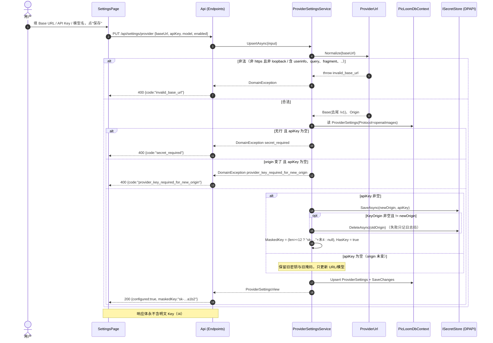
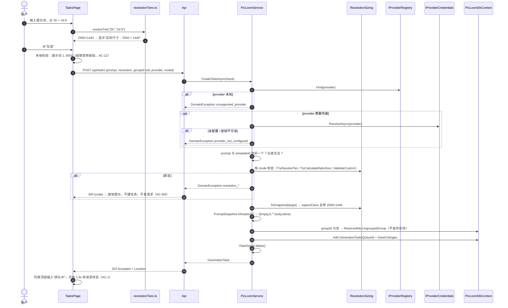
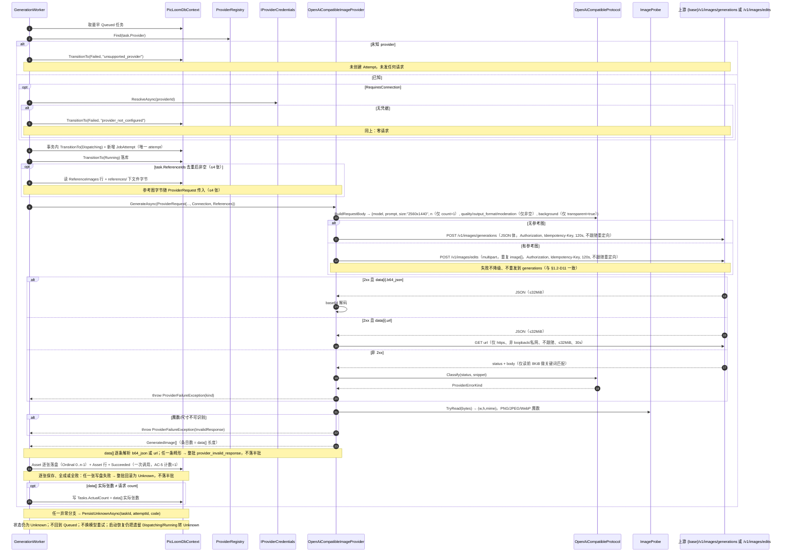
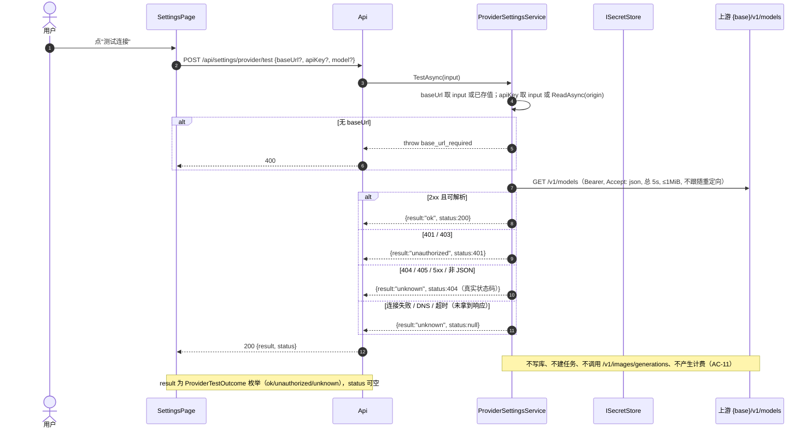

# PicLoom 增量架构 P0.5：BYOK 开箱即用

> 输入：`docs/product/increment-01-byok-quickstart.md`（10 条 P0 / 15 条 AC / 5 个待确认项，全部按推荐默认执行）、`docs/architecture.md`（Provider 扩展点）。
> 约束：**不新增第三方依赖**；测试口径以真实上游为准 —— 仓库仅保留 `tests/PicLoom.LiveTests`（3 条真实中转站调用：文生图、单参考图 `edits`、`count=2`；无凭证时 Skip，不作为构建门禁），日常回归以真实冒烟 + `scripts/logs.ps1` 日志字段核对为准。对外契约仍须向后兼容（见 §4.1）。
> 只做设计，不改源码/测试/前端。

---

## 1. 方案总览与关键取舍

### 1.1 一句话方案

把"模板 → 分辨率 → 分组"三段前置全部降级为可选：新增内置 **"未分组"系统分组**、新增**内联提示词来源**、新增**后端权威的 24 挡分辨率目录（8 比例 × 3 档）+ 自动（不发 `size`）+ 自定义比例**、把单例 Provider 换成**按 Id 注册表的适配器**（当前仅 `openai-images`，内置演示 Provider 已下线）、新增 **BYOK 设置表 + 三态测试连接**、新增 **四条结构化日志事件**（`provider.dispatch`/`provider.success`/`provider.failure`/`task.transition`，见 §6.3），并把上游失败归一化成 8 类 `provider_*` 错误码（任务状态仍一律 `Unknown`，绝不重发）。

### 1.2 关键取舍

| # | 取舍点 | 结论 | 选它的理由 | 不选另一条的理由 |
|---|---|---|---|---|
| D1 | `GenerationTask.GroupId` 是否改 `Guid?` | **不改**（已由 team-lead 正式采纳，不再保留真 NULL 列备选）。保持 `Guid` 非空，新增**内置"未分组"分组行**（固定 Guid + `IsSystem` 列），"未分组"= 系统分组 | SQLite 上 `Tasks.GroupId` 改可空必须**重建 Tasks 表**；SQLite 在执行 `DROP TABLE Tasks` 时会因 `Attempts`/`Assets` 的 `ON DELETE CASCADE` **隐式级联删掉历史尝试与资产**，属不可接受的数据风险。系统分组只需 `ALTER TABLE Groups ADD COLUMN`，零重建、零数据搬运 | 改可空还需连带处理 `PromptSnapshot`/外键 Restrict、索引重建、以及前端 `Task.groupId: string` → `string \| null` 的全量改造，收益仅为"少一行数据" |
| D2 | 内联提示词如何表达 | `PromptSnapshot` **新增第 5 个字段** `Source`（`template`/`inline`，默认 `template`），内联时 `TemplateId = Guid.Empty`、`Revision = 0`、`Name = ""` | 位置记录加**带默认值的尾参**，历史 JSON（无 `source`）反序列化即为 `template`，历史快照语义零变化；`Name = ""` 避免把中文字面量写进不可变数据 | 只用 `TemplateId == Guid.Empty` 约定：语义隐含、前端和未来适配器都要靠猜；改 `TemplateId` 为可空则破坏 `SnapshotImmutabilityTests` 的 `Guid.Parse(...)` 断言 |
| D3 | 分辨率挡位在哪算 | **Core 内一份权威目录**（`ResolutionTiers`），**后端校验为准**，前端另持一份同表用于即时显示 | AC-10 要求 24 挡逐条一致，后端必须能独立拒绝任何非法组合（I5：校验必须在派发前本地拦截）；前端持副本只为 0 延迟显示 | 只在前端算：服务端就成了"信任客户端"的转发器，违反 I5；只在后端算：用户点选后要等一次往返才见宽高 |
| D4 | 挡位如何落到 `ResolutionSnapshot` | 见 §3.3。挡位 → `Mode = aspectClass` 且**带具体 width/height**；自定义 → `Mode = exactPixels`；`ProfileId = Guid.Empty`、`Name = ""` | 复用既有 7 字段快照，"16:9 · 2K = 2560×1440"三项信息齐全，前端无需新字段即可渲染；历史 `aspectClass` 快照（width/height 为 null）仍可读 | 新增第三种 `ResolutionMode`：会连带改 `ResolutionProfile` 校验、前端枚举、`resolutions.mode.*` 文案与既有测试断言 |
| D5 | Provider 如何解析 | 单例 `IImageProvider` → `IEnumerable<IImageProvider>` + `ProviderRegistry.Find(id)`，Worker 按 `task.Provider` 取 | 架构文档明确要求"真实 Provider 必须独立适配器"，注册表是唯一不污染 Endpoint 的做法 | 按模型名/URL 猜协议：架构文档明令禁止 |
| D6 | 未知 / 未配置 Provider | **派发前本地拦截**：未知 provider → `Failed` + `unsupported_provider`；需要凭据但未配置 → `Failed` + `provider_not_configured`。两者都在**创建 Attempt 之前** | 保持 I5（一次任务=一次上游调用）与 I1/I2（不重发）；`Failed` 而非 `Unknown` 是因为**确实没有发出请求**，语义更准确 | 派发后再失败：会凭白消耗一次"未知结果"语义，用户看到"结果未知"却其实什么都没发 |
| D7 | 密钥存储 | 复用 `ISecretStore`（DPAPI，按 origin 加密 + 派生熵）；`ProviderSettings.KeyOrigin` 记录该密钥对应的 origin | 不分叉既有安全组件；熵绑定 origin 的既有设计正好能防跨站点密钥替换 | 把 Key 存进 SQLite：违反 I4（明文落库） |
| D8 | 换 Base URL 时的密钥 | 规则见 §3.4：**origin 变了且未给新 Key → 拒绝**（`provider_key_required_for_new_origin`）；给了新 Key → 写新 origin 后**删除旧 origin 的密钥文件** | "空 Key 表示不变"只在同一 origin 内成立；跨 origin 沿用会让密钥永远用不上且留下孤儿文件 | 静默把旧密钥搬到新 origin：等于用户换个 URL 就能把密钥发到任意主机，风险不可控 |
| D9 | Base URL 协议 | **必须 https；仅允许 http + loopback**（`localhost` / `127.0.0.1` / `[::1]`） | 本地中转（one-api、LM Studio、测试桩）必须能用；loopback 流量不出网卡，密钥不出本机 | 一律 https：本地代理完全无法接入，也让集成测试必须依赖外部网络 |
| D10 | 上游返回 `url` | **支持，但强约束**：仅 https、非 loopback/私网、不跟随重定向、≤32 MiB、30 s | 产品决策明确写了协议返回 `b64_json` **或** `url`；只认 b64 会让部分中转站直接不可用 | 无条件下载任意 url：SSRF + 密钥/内网探测面；不限制会被 1GB 响应打爆内存 |
| D11 | 上游 `size` 取值 | 直接下发快照的 `"{w}x{h}"`（如 `2560x1440`），**不二次缩放、不吸附到 OpenAI 官方 3 个尺寸**；唯一例外是 `Mode == Auto`：**请求体完全不写 `size` 成员**（不是空串、不是占位值），由模型自选尺寸 | PRD §3.1 第 5 条明确"表中数值即最终下发值，不再二次缩放"；目标用户是中转站。省略 `size` 对官方 API（其 `auto` 等于缺省）与"拒绝未知枚举"的中转站都安全 | 吸附到 `1024x1024/1536x1024/1024x1536`：会把 4K 需求静默降级，违背用户预期（风险见 §9-R1）。`Auto` 若写字面量 `"auto"`：部分中转站会 400，反而把"让模型自选"变成必然失败 |
| D12 | 上游失败分类 | 新增 `ProviderErrorKind`（8 类）→ 具体 `provider_*` 码写入 `ErrorCode`；任务状态**一律 `Unknown`** | AC-5/6/7 要求"1 次 POST + Unknown + 分级文案"，错误码必须能驱动 6 类文案 | 按状态码给不同任务终态（如 401 进 Failed）：违反 PRD §4.2 终态列 |
| D13 | 测试连接探测 | 只 `GET {base}/v1/models`，总超时 **5 s**、响应 **≤1 MiB**；三态 `ok`/`unauthorized`/`unknown` | Q1 推荐默认；绝不调用生图接口，天然满足"无计费、无新任务" | 用生图探测：会计费且污染"不重发"语义 |
| D14 | 挡位是否走 `ResolutionProfile` | **不走**。挡位在创建任务时直接产一次性 `ResolutionSnapshot`；`ResolutionProfile` 白名单**不扩展**（仍 5 比例）、`exactPixels` 上限**不放宽**（仍 8192）。详见 §3.6 | 挡位是系统固定的 24 档只读目录，档案是用户可编辑的预设，两套语义混在一起会出现"用户改了预设 → 历史挡位含义漂移"；且 `aspectClass` 只允许 5 比例、`exactPixels` 上限 8192 与挡位规则（8 比例、≤3840）直接冲突，扩展白名单还会牵动既有分辨率档案校验逻辑 | (a) 扩白名单到 8 比例 + 给挡位加 ≤3840 约束：同一字段两套校验分支，`ResolutionProfile` 变成"有时是预设、有时是挡位容器"，且 `/api/resolutions` 的合法输入集合被本增量悄悄改大，老客户端行为虽不变但语义漂移 |

---

## 2. 文件清单

### 2.1 新增

| 相对路径 | 说明 |
|---|---|
| `src/PicLoom.Core/ResolutionTiers.cs` | 24 挡目录表（8 比例 × 3 档）、`ResolutionTier`/`ResolutionTarget`（含显式 `Mode`）、自定义像素校验、自定义比例计算（`TryParseRatio`/`SimplifyRatioKey`/`TryCalculateRatioSize`）、`ResolutionSizing`（快照↔宽高↔`size` 字符串；`Auto` 不产 `size`） |
| `src/PicLoom.Core/ProviderErrors.cs` | `ProviderErrorKind` 枚举、`ProviderFailureException`、kind→码映射 |
| `src/PicLoom.Core/ProviderUrl.cs` | Base URL 规范化（去尾 `/v1`）、origin 推导、images/models URL 生成、loopback 判定 |
| `src/PicLoom.Core/ProviderSettings.cs` | `ProviderProtocol` 枚举、`ProviderSettings` 实体、`ProviderSettingsInput/View`、密钥掩码规则 |
| `src/PicLoom.Infrastructure/Providers/ProviderRegistry.cs` | `ProviderRegistry : IProviderRegistry`，由 `IEnumerable<IImageProvider>` 构造 |
| `src/PicLoom.Infrastructure/Providers/OpenAiCompatibleImageProvider.cs` | OpenAI 兼容生图适配器（唯一真实 Provider） |
| `src/PicLoom.Infrastructure/Providers/OpenAiCompatibleProtocol.cs` | 请求体构造、响应解析（b64/url）、HTTP 状态与响应体关键词 → `ProviderErrorKind` 归类（纯函数，可单测） |
| `src/PicLoom.Infrastructure/Providers/ImageProbe.cs` | 按魔数判定 PNG/JPEG/WebP 并读出宽高（替代原 `PngSize` 辅助方法并扩展） |
| `src/PicLoom.Infrastructure/Providers/ProviderTransport.cs` | `IProviderTransport` + 默认 `SocketsHttpHandler`（禁重定向、连接超时 5 s），供测试替换 |
| `src/PicLoom.Infrastructure/Services/ProviderSettingsService.cs` | BYOK 设置的读写/清除/测试连接/派发前凭据解析（实现 `IProviderCredentials`） |
| `src/PicLoom.Infrastructure/Persistence/Migrations/20261028042833_ByokQuickstart.cs` `.Designer.cs` | 新增迁移（`Groups.IsSystem` + 种子系统分组 + `ProviderSettings` 表）。**文件名时间戳由 `dotnet ef migrations add` 生成**，以实际产出为准（实现落盘为 `20261028042833`） |
| `docs/architecture/increment-01-byok.md` | 本文档 |
| `docs/architecture/increment-01-byok.class.mermaid` | 类图单独文件 |
| `docs/architecture/increment-01-byok.sequence.mermaid` | 时序图单独文件 |

### 2.2 修改

| 相对路径 | 改什么 |
|---|---|
| `src/PicLoom.Core/Contracts.cs` | `CreateTaskInput` 改为全可选成员（旧字段保留，语义见 §4.1）；`ProviderRequest` 追加 `Connection`；`IImageProvider` 追加 `RequiresConnection`；新增 `IProviderRegistry`、`IProviderCredentials`、`IProviderSettingsService`、`ProviderConnection`。**`IPicLoomService` 不扩张**（BYOK 走独立 `IProviderSettingsService`，避免任务用例接口继续膨胀） |
| `src/PicLoom.Core/Catalog.cs` | 新增 `PromptSource` 枚举；`PromptSnapshot` 追加 `Source`（默认 `template`）与 `FromTemplate`/`Inline` 工厂；`TaskGroup` 追加 `IsSystem`；新增 `ReservedIds.UngroupedGroup`；`ResolutionMode` **末尾追加** `Auto`（存储层是数值枚举，只能追加，见 §8） |
| `src/PicLoom.Infrastructure/Persistence/PicLoomDbContext.cs` | `DbSet<ProviderSettings>` 与映射；`Groups.IsSystem` 映射；`Tasks` 其余不变 |
| `src/PicLoom.Infrastructure/Persistence/Migrations/PicLoomDbContextModelSnapshot.cs` | 由 `dotnet ef migrations add` 自动重写 |
| `src/PicLoom.Infrastructure/Security/DpapiSecretStore.cs` | `NormalizeOrigin` 放行 loopback 的 http（唯一改动，其余不动） |
| `src/PicLoom.Infrastructure/Providers/`（内置演示 Provider 两个文件） | **删除**：演示 Provider 及其 PNG 生成器已下线，不再提供无凭据试跑；`ImageProbe` 承接其尺寸解析职责 |
| `src/PicLoom.Infrastructure/Assets/LocalAssetStore.cs` | 文件扩展名由 `image.MimeType` 决定（`png`/`jpg`/`webp`），不再硬编码 `image.png`；契约与路径校验逻辑不变 |
| `src/PicLoom.Infrastructure/Generation/GenerationWorker.cs` | 按注册表解析 Provider；派发前取凭据；新增 `ProviderFailureException` 分支；`PersistUnknownAsync` 增加 `code` 参数 |
| `src/PicLoom.Infrastructure/Services/PicLoomService.cs` | `CreateTaskAsync` 全部新校验与快照构造；`GetGroupsAsync` 排序；`DeleteGroupAsync`/`UpdateGroupAsync` 保护系统分组 |
| `src/PicLoom.Infrastructure/InfrastructureRegistration.cs` | 注册 `IImageProvider`（仅 `openai-images`）+ 注册表 + 设置服务 + `picloom-openai-images` 命名客户端 |
| `src/PicLoom.Api/Endpoints.cs` | 新增 4 个 `/api/settings/provider*` 端点；`/api/tasks` 与 `/api/groups` 契约扩展；`/health` 修正 |
| `src/PicLoom.Api/ApiApplication.cs` | 异常映射：`group_reserved` → 409（其余新码沿用默认 400） |
| `src/PicLoom.Web/src/types.ts` | `Provider` 固定为 `'openai-images'`（`typeof OPENAI_PROVIDER`，历史任务的其它 provider 字符串原样透传显示）；`Task.model` → `string`；`Task.groupId` 保持 `string`；`TaskGroup.isSystem`；`PromptSnapshot.source`；`ResolutionSnapshot.profileId`；`TaskCreateInput` 全可选；新增 BYOK 与挡位类型 |
| `src/PicLoom.Web/src/api/client.ts` | 新增 4 个 settings 方法；`listTasks(groupId?: string)`；`KNOWN_ERROR_CODES` 增补 |
| `src/PicLoom.Web/src/lib/resolutionTiers.ts` | **新增**：24 挡一份表（8 比例 × 3 档，与后端同序）+ `resolveTier` / `resolveRatio` / `validateCustomSize`（与后端同序同码） |
| `src/PicLoom.Web/src/components/SizePickerModal.tsx` | **新增**：尺寸弹窗，三页签（自动 / 挡位 / 自定义比例或像素）；原"分辨率"导航项与页面已删除 |
| `src/PicLoom.Web/src/lib/byok.ts` | ~~新增~~ **实际未创建**（见 §10-C5）：三块职责分别天然归属 —— Base URL 校验由后端权威做、前端只映射 `errors.invalid_base_url` 文案；掩码直接取 API 的 `maskedKey`，前端零密钥运算；三态文案是 3 个 i18n 键。逻辑内联于 `SettingsPage.tsx` + `i18n/labels.ts`，**刻意不建第二份可漂移实现** |
| `src/PicLoom.Web/src/i18n/labels.ts` | `formatModel` 支持任意 model 字符串；新增 `providerLabel`、`resolutionFromSnapshot` |
| `src/PicLoom.Web/src/i18n/messages.zh-CN.ts` / `messages.en.ts` | 新增 `tasks.inline.*`、`tasks.tier.*`、`tasks.byok.*`、`settings.provider.*`、`errors.provider_*`、`groups.ungrouped` 等键 |
| `src/PicLoom.Web/src/pages/TasksPage.tsx` | 去掉"无分组即阻断"；内联提示词表单 + 尺寸入口（`SizePickerModal`：自动 / 24 挡 / 自定义比例 / 精确像素）+ 模型下拉（含自定义）+ 分组默认"未分组" + 状态 A 顶部提示 + 列表筛选"全部/未分组/某组"；`/api/resolutions` 仅保留给旧入口，任务页不再使用 |
| `src/PicLoom.Web/src/pages/SettingsPage.tsx` | 新增 BYOK 卡片（Base URL / API Key / 模型名 + 保存 / 测试连接 / 清除 + 掩码态） |
| `src/PicLoom.Web/src/pages/TaskDetail.tsx` | Provider/模型显示修正；`Unknown` 六类文案 + "系统不会自动重发"；内联提示词标签 |
| `tests/PicLoom.UnitTests/ResolutionTierTests.cs` | **新增**：24 挡逐条断言 + 自定义像素规整规则 + 自定义比例计算（含预设命中与自由比例搜索） |
| `tests/PicLoom.UnitTests/ProviderUrlTests.cs` | **新增**：规范化、origin、loopback、非法输入 |
| `tests/PicLoom.UnitTests/ProviderErrorMappingTests.cs` | **新增**：状态码/关键词 → kind |
| `tests/PicLoom.Api.IntegrationTests/ProviderSettingsTests.cs` | **新增**：掩码、重启保留、清除、换 origin 拒绝、测试连接三态 |
| `tests/PicLoom.Api.IntegrationTests/InlineTaskTests.cs` | **新增**：内联任务、未分组、挡位校验、旧路径兼容 |
| `tests/PicLoom.Api.IntegrationTests/OpenAiProviderTests.cs` | **新增**：用假传输断言"1 次 POST + Unknown + 对应 errorCode" |
| `tests/PicLoom.Api.IntegrationTests/FakeProviderTransport.cs` | **新增**：`IProviderTransport` 的测试替身（记录 POST 次数、按脚本返回状态码/响应体/断连），由 `customize` 注入替换 |
| `tests/PicLoom.UnitTests/ImageProbeTests.cs` | **新增**：PNG/JPEG/WebP 魔数与尺寸解析、非图片字节被拒 |
| `tests/PicLoom.UnitTests/SnapshotSerializationTests.cs` | **新增**：历史快照 JSON（**数字枚举、无 `source` 成员**）仍可反序列化，覆盖 §10-C2 |
| `src/PicLoom.Web/tests/resolutionTiers.test.ts` | **新增**：24 挡逐条与后端表对齐、`validateCustomSize` 错误码顺序 |
| `src/PicLoom.Web/tests/settings.test.tsx` | **新增**：BYOK 卡片掩码态、三态文案、清除二次确认 |

> ⚠️ 测试口径（与开篇一致）：表中 `tests/PicLoom.UnitTests/*`、`tests/PicLoom.Api.IntegrationTests/*`、`src/PicLoom.Web/tests/*` 在当前仓库**已不存在** —— 测试体系改为仅保留 `tests/PicLoom.LiveTests`（3 条真实中转站调用：文生图、单参考图 `edits`、`count=2`；无凭证时 Skip，不作为构建门禁）。此表与 T01/T04 涉及文件中的单元/集成测试项仅作设计期覆盖记录，**不得据此宣称存在对应测试或"全部通过"**；日常回归以真实冒烟 + `scripts/logs.ps1` 日志字段核对为准。

---

## 3. 数据模型变更

### 3.1 表结构

**无破坏性变更**：不重建任何既有表，不改任何既有列的约束。

| 表 | 变更 | 列定义 | 说明 |
|---|---|---|---|
| `Groups` | **+1 列** | `IsSystem INTEGER NOT NULL DEFAULT 0` | 标记系统分组；API 创建的分组恒为 0 |
| `Groups` | **+1 行（种子）** | `Id = 00000000-0000-0000-0000-000000000001`、`Name = '未分组'`、`IsSystem = 1`、`CreatedAt/UpdatedAt = 2000-01-01T00:00:00Z` | 幂等的 `InsertData`，仅在迁移中执行一次 |
| `ProviderSettings` | **新表** | 见下表 | 单行（每协议一行），预留 P2-1 |
| `Tasks` | 无变化 | `GroupId TEXT NOT NULL` + FK `Restrict` | 由系统分组承接"未分组" |
| `Templates` / `Resolutions` / `Attempts` / `Assets` | 无变化 | — | 表名改为"提示词预设"/"分辨率档案"仅是文案 |

`ProviderSettings`：

| 列 | 类型 | 可空 | 约束 | 说明 |
|---|---|---|---|---|
| `Id` | TEXT | 否 | PK | Guid |
| `Protocol` | TEXT(32) | 否 | **唯一索引** | 字符串枚举 `openaiImages` |
| `DisplayName` | TEXT(120) | 否 | — | 固定 `OpenAI 兼容（BYOK）` |
| `BaseUrl` | TEXT(512) | 否 | — | 规范化后的绝对 URL（可能含路径，不含 `/v1` 尾） |
| `Model` | TEXT(120) | 否 | — | 记忆的默认模型名（可空语义用空串） |
| `KeyOrigin` | TEXT(256) | 否 | — | 密钥在 `ISecretStore` 中的键（`scheme://host[:port]`），未配置时为空串 |
| `MaskedKey` | TEXT(32) | 是 | — | 已渲染掩码，如 `sk-…a1b2`；密钥不足 12 位时为 null |
| `HasKey` | INTEGER | 否 | — | 布尔，密钥文件是否应存在 |
| `IsEnabled` | INTEGER | 否 | — | 布尔，默认 1 |
| `CreatedAt` / `UpdatedAt` | TEXT | 否 | — | UTC，沿用既有 `UtcDateTimeConverter` |

### 3.2 迁移策略（一次性、无重建）

迁移文件：`src/PicLoom.Infrastructure/Persistence/Migrations/20261028042833_ByokQuickstart.cs`（文件名时间戳由 `dotnet ef migrations add` 生成，非人工可控；以实际产出为准）。

```
1. AddColumn Groups.IsSystem (INTEGER, NOT NULL, defaultValue: false)
2. InsertData Groups(Id, Name, CreatedAt, UpdatedAt, IsSystem)
3. CreateTable ProviderSettings + CreateIndex IX_ProviderSettings_Protocol (unique)
```

**`Up()` 实际 SQL 已核验**：仅 `AddColumn`（`Groups.IsSystem`）／`CreateTable`（`ProviderSettings`，含唯一索引）／`InsertData`（系统分组）三类操作，**无 `DropTable`、无 `AlterColumn`**，未触碰 `Tasks`／`Attempts`／`Assets`／`Templates`／`Resolutions`。

**明确不做的事**（避免踩 SQLite 重建陷阱）：

- 不 `AlterColumn Tasks.GroupId` → 不需要 `ef_temp_Tasks` 重建 → 不存在 `DROP TABLE Tasks` 触发 `Attempts`/`Assets` 级联删除的路径。
- 不 `DropTable` / 不重建 `Attempts`、`Assets`。
- 既有任务行、快照 JSON、资产文件、密钥文件**一律不触碰**（满足 AC-14、AC-3）。

> 若将来确实需要真正的 NULL 列，必须写成"显式 SQL + `PRAGMA foreign_keys=0` 包裹 + 按 `Assets → Attempts → Tasks` 逆序重建"，不得交给 EF 自动生成。

### 3.3 快照承载

| 来源 | `PromptSnapshot` | `ResolutionSnapshot` |
|---|---|---|
| 旧路径（`templateId`） | `(TemplateId, Revision, Name, Body, Source=template)` — 与今日完全一致 | 来自 `ResolutionProfile.Snapshot()`，原样 |
| 预设填入后提交 | 同上（前端把预设正文填进提示词框后按 `prompt` 提交亦可，此时为 `inline`） | — |
| 内联提示词 | `(Guid.Empty, 0, "", Body, Source=inline)`，`Body` 长度 1–8000 | — |
| 挡位 | — | `(Guid.Empty, "", aspectClass, 2560, 1440, "16:9", "2K")` |
| 自定义比例 | — | `(Guid.Empty, "", aspectClass, 1392, 1120, "5:4", "1K")`（命中 8 个预设键 → 直接取固定表；非预设比例 → 按 §8 算法算出，`aspectRatio` 存用户输入文本） |
| 自动 | — | `(Guid.Empty, "", Auto, null, null, null, null)` — **width/height/aspectRatio/imageSize 四项全为 null** |
| 自定义尺寸 | — | `(Guid.Empty, "", exactPixels, 1280, 1024, null, null)`（示例值不在 24 挡表内，合法自定义：16 倍数、5:4、像素在区间内） |
| `Tasks.OptionsJson`（新列，JSON，可空） | **不进** `PromptSnapshot` | **不进** `ResolutionSnapshot`：五个生成参数（`quality` / `count` / `format` / `transparent` / `moderation`）作为**独立列**承载，全默认时**该列为 NULL**（不写 `"{}"`），读侧 NULL 即全默认 |
| `Tasks.ActualCount`（新列，int，可空） | 不进 | 不进：仅当"响应 `data[]` 实际张数 ≠ 请求 `count`"时回填；正常一致时为 NULL |
| `ReferenceImages`（新关系表） | 不进 | 不进：`(Id, TaskId NULL, RelativePath, ThumbnailPath, MimeType, Width, Height, Source, Ordinal, CreatedAt)`，`TaskId` 外键 Cascade、索引 `(TaskId, Ordinal)`；`TaskId` 为空 = 未绑定（可删除） |

- **参考图字节不进快照，只存路径与元数据**：`ReferenceImages` 每张一行，承载 `RelativePath`（数据目录 `references/` 下的相对路径）、`ThumbnailPath`、`MimeType`/`Width`/`Height`/`Source`/`Ordinal`；任务行与两次快照 JSON **都不 embedding 任何图片字节或 base64**，`Tasks.OptionsJson` 亦只存用户显式给的参数。以上 3 项由迁移 `20261028120000_AddImageInputsAndOptions` **加法式**引入（新表 + 新可空列 + 索引替换，无表重建）。
- **`aspectClass` 快照现在可能带非空 width/height**（挡位与自定义比例两路都带具体像素），**也可能 width/height 全为 null**（仅 `Mode == Auto`，此时 `aspectRatio`/`imageSize` 同样为 null）：任何读取方（含前端）不得再假设"aspectClass ⇒ width/height 为 null"，也不得假设"aspectClass ⇒ aspectRatio 非空"。历史行仍是 width/height 为 null 但 `aspectRatio + imageSize` 有值，渲染逻辑必须三路兼容（有像素 / 只有比例档 / 四项全空）。
- 旧 `aspectClass` 档案（只存比例不存像素）在**新建任务**时按**新 24 挡表**换算成具体宽高写入快照；**历史快照不受影响**（快照是不可变事实，不为老行重算）。
- 历史 `aspectClass` 档位（5 比例 × 3 尺寸 = 15 组合）**全部命中**新 24 挡表，因此 `size` 字符串解析不存在不可表示的历史数据。
- `ResolutionProfile` 的强校验（`aspectClass` 必须 width/height 为 null）**保持不变**，仅作用于档案实体，不作用于快照。

### 3.4 密钥与 origin 生命周期

```
origin = ProviderUrl.Normalize(baseUrl).Origin        // https://host[:port]，http 仅 loopback

PUT /api/settings/provider
  ├ 无已有行           → 必须给 apiKey → SaveAsync(origin,key) / HasKey=1 / 写 MaskedKey+KeyOrigin
  ├ origin 未变
  │   ├ apiKey 为空    → 保留旧密钥，只更新 BaseUrl/Model/IsEnabled（"保留旧 Key 只改 URL/模型"）
  │   └ apiKey 非空    → SaveAsync(origin,key) 覆盖，刷新掩码
  └ origin 已变
      ├ apiKey 为空    → 400 provider_key_required_for_new_origin（不写库）
      └ apiKey 非空    → SaveAsync(newOrigin,key) → DeleteAsync(oldOrigin)（best-effort，仅记日志码）
                        → KeyOrigin=newOrigin，刷新掩码

DELETE /api/settings/provider → DeleteAsync(KeyOrigin) / HasKey=0 / MaskedKey=null / IsEnabled=0
                                （BaseUrl 与 Model 保留，方便重填）
```

- 残留风险：历史上被"跳过删除"的孤儿密钥文件无法枚举回收（文件名是 origin 的 SHA-256）。设计上用"每次换 origin 就删旧文件"把它压到唯一可控路径，其余不追。
- `NormalizeOrigin` 需放行 `http` + loopback，否则本地中转无法保存密钥。

### 3.5 24 挡权威表（8 比例 × 3 档，`ResolutionTiers` 的唯一数据源，逐字照抄 CookSleep `COMMON_SIZE_PRESETS`）

比例顺序固定为 `1:1, 3:2, 2:3, 16:9, 9:16, 4:3, 3:4, 21:9`（比例优先排序，档位内序 `1K → 2K → 4K`）：

| 比例 | 1K | 2K | 4K |
|---|---|---|---|
| `1:1` | 1024×1024 | 2048×2048 | 2880×2880 |
| `3:2` | 1536×1024 | 2160×1440 | 3456×2304 |
| `2:3` | 1024×1536 | 1440×2160 | 2304×3456 |
| `16:9` | 1280×720 | 2560×1440 | 3840×2160 |
| `9:16` | 720×1280 | 1440×2560 | 2160×3840 |
| `4:3` | 1024×768 | 2048×1536 | 3200×2400 |
| `3:4` | 768×1024 | 1536×2048 | 2400×3200 |
| `21:9` | 1280×544 | 2560×1088 | 3840×1600 |

自检（AC-10）：24 组全部为 16 的倍数；单边最大 3840；比例最大约 2.4:1（`21:9`，未触及 3:1 上限）；总像素区间 **696 320 – 8 294 400**（`1280×544` 最小；`2880²`、`3840×2160`、`2160×3840` 恰好等于上限）。表值即最终下发值（PRD §3.1 第 5 条），**不做二次缩放、不吸附官方尺寸**；`Auto` 例外，见 §4.1。

- **固定表不受 §8 的 1% 误差约束**：`21:9` 三档是按 16 倍数对齐后的实际下发值（`1280/544` ≈ 2.353、`2560/1088` ≈ 2.353、`3840/1600` = 2.4），与理论 2.333 的偏差最大约 2.9%，属表的一部分；1% 只约束**自定义比例**的搜索结果，测试不要拿预设去套 1%。
- 4K 档取的是同比例下对齐 16 倍数、不越像素上限的**整齐档位**（与 CookSleep 表一致），不是该比例在规则内可取的最大值。

自定义尺寸示例（供前端与测试共用，错误码按 §8 顺序）：

| 输入 | 首个命中错误码 | 提示示例 |
|---|---|---|
| `1000×1000` | `resolution_not_multiple_of_16` | 宽高需为 16 的倍数（调整为 992 或 1008） |
| `4096×1024` | `resolution_edge_too_large` | 单边不能超过 3840 |
| `3840×1024` | `resolution_aspect_too_extreme` | 宽高比不能超过 3:1（当前 3.75:1） |
| `256×256` | `resolution_pixels_out_of_range` | 总像素需在 655 360 – 8 294 400 之间 |
| `0×1024` | `resolution_invalid` | 宽高必须为正整数 |

### 3.6 结论：挡位**不落** `ResolutionProfile`（选项 b）

**决策：选 (b)。** 挡位在创建任务时由 `ResolutionSizing.ToSnapshot()` 直接产一次性 `ResolutionSnapshot`，全程不读、不写 `ResolutionProfiles` 表。

**为什么不能选 (a)**：

| 冲突点 | 现状 | 挡位要求 | 选 (a) 的后果 |
|---|---|---|---|
| 比例白名单 | `aspectClass` 仅 `1:1/16:9/9:16/4:3/3:4`（5 种） | 8 种（+`3:2`/`2:3`/`21:9`） | 必须改 `ResolutionProfile.Update` 的校验分支 → 既有 `ResolutionProfileTests`（12 个断言）需重写，等于把本增量的验证成本转嫁到"用户预设"功能上 |
| 边长上限 | `exactPixels` 允许 `1..8192` | 单边 ≤3840 | 同一列出现两套上限：用户档案 8192、挡位 3840 → 校验必须按"这行是预设还是挡位"分流，`ResolutionProfile` 同时承担两种身份 |
| 语义归属 | 用户可自由新建/改名/删除的**可编辑预设** | 系统只读的**固定目录** | 用户删掉/改名"16:9 2K"档案后，挡位语义就漂移；挡位必须与用户编辑解耦 |
| 幂等 | 档案是可变行，靠 `Snapshot()` 冻结 | 挡位本身不可变 | 两套"不可变"实现，多一层无收益映射 |

**选了 (b) 之后，两个合法集合完全隔离，互不影响**：

| 集合 | 定义处 | 校验 | 是否可变 | 历史兼容 |
|---|---|---|---|---|
| 用户分辨率档案 | `ResolutionProfile`（`src/PicLoom.Core/Catalog.cs`） | **原封不动**：`aspectClass` 5 比例 + `1K/2K/4K`；`exactPixels` `1..8192` | 可增删改 | 既有行与 `/api/resolutions` 契约行为全部不变 |
| 系统挡位 | `ResolutionTiers`（新增 `src/PicLoom.Core/ResolutionTiers.cs`） | 24 组 `(imageSize, aspectRatio) → (w,h)` 常量；自定义像素、自定义比例按 §8 规则 | 只读常量 | 不涉及 |

**历史数据可读性保证（逐条对应 AC-14）**：

1. `ResolutionSnapshot` 结构**不变**（仍是 7 字段），因此历史快照 JSON 原样反序列化。
2. 历史 `aspectClass` 快照（`width/height` 为 null）仍有 15 个组合（5 比例 × 3 尺寸），**全部命中**新 24 挡表 → 派发时 `ResolutionSizing.TryResolveTier` 必定成功，不存在"历史任务无法再派发"的路径。
3. 历史 `exactPixels` 快照（可能 >3840，因旧上限 8192）**不重新校验**：快照是事实，只用于生成 `size` 字符串，不再过 3840 闸门。
4. 前端渲染规则：`width && height` 都存在 → 显示"W × H"；`imageSize + aspectRatio` 都存在 → 追加"比例 · 挡位"标签。两路并存，不依赖 `mode` 值判断来源。
5. `/api/resolutions` 请求/响应/校验/排序/错误码**零改动**，老客户端行为不变。

**（可选，本次不做）** 分辨率页未来可加一个只读"系统挡位"分区展示这 24 档，纯展示、不可编辑、不产生数据库行。本次前端已把"分辨率"导航项与页面整体删除，`/api/resolutions` 后端接口**保留未动**（老客户端继续可用）。

---

## 4. 接口契约

### 4.1 `POST /api/tasks`（扩展，向后兼容）

现测试用请求体 `{templateId, resolutionId, groupId, provider, model}` **必须继续工作**，故 `CreateTaskInput` 所有成员改为可选，两条路径并存。`resolution` 对象新增**显式判别字段 `mode`**（四值：`auto` / `tier` / `ratio` / `pixels`），旧请求体缺省它时按旧字段推断，行为完全不变：

```jsonc
// 新路径 A：自动（不发 size，模型自选尺寸）
{ "prompt": "一只在雨夜霓虹街头撑伞的橘猫，电影感光线", "templateId": null,
  "resolution": { "mode": "auto" },
  "resolutionId": null, "groupId": null, "provider": "openai-images", "model": "gpt-image-1" }

// 新路径 B：挡位（24 挡，imageSize + aspectRatio）
{ "prompt": "…", "resolution": { "mode": "tier", "imageSize": "2K", "aspectRatio": "16:9" },
  "groupId": null, "provider": "openai-images", "model": "gpt-image-1" }

// 新路径 C：自定义比例（imageSize 决定 tier 预算，aspectRatio 任意 "a:b"/"axb"/"a×b"）
{ "prompt": "…", "resolution": { "mode": "ratio", "imageSize": "2K", "aspectRatio": "5:4" },
  "groupId": null, "provider": "openai-images", "model": "gpt-image-1" }
//  → 后端算出 2288×1824，快照 aspectRatio 存 "5:4"

// 新路径 D：精确像素
{ "prompt": "…", "resolution": { "mode": "pixels", "width": 1280, "height": 1024 },
  "groupId": "…", "provider": "openai-images", "model": "gpt-image-1" }

// 旧路径（只给旧字段、无 prompt/resolution/mode，按字段推断，必须保持 202 + Queued）
{ "templateId": "…", "resolutionId": "…", "groupId": "…", "provider": "openai-images", "model": "gpt-image-1" }
```

**图生图与五参数：`CreateTaskInput` 增加 `referenceIds`（`Guid[]?`，0..4）与 `options`（可空对象）**，两者与 `mode` 正交，可任意组合：

```jsonc
// 仅参考图（options 缺省 = 全默认：count=1，quality/format/moderation=null，transparent=false）
{ "prompt": "把这件外套换成墨绿色", "referenceIds": ["<guid>"],
  "resolutionId": "…", "groupId": null, "provider": "openai-images", "model": "gpt-image-1" }

// 参考图 + 全参数
{ "prompt": "…", "referenceIds": ["<guid>"],
  "options": { "quality": "high", "count": 4, "format": "png", "transparent": false, "moderation": "low" },
  "resolution": { "mode": "tier", "imageSize": "2K", "aspectRatio": "16:9" },
  "groupId": null, "provider": "openai-images", "model": "gpt-image-1" }
```

`options` 成员语义（**全部可省略**；`options` 整体为 `null` 时等价于全默认，落库 `Tasks.OptionsJson = NULL`）：

| 成员 | 取值 | 缺省 | 说明 |
|---|---|---|---|
| `quality` | `"low"` / `"medium"` / `"high"` / `null` | `null` | `null` = 不写 `quality` 成员，由上游默认 |
| `count` | `1`..`4` 整数 | `1` | `1` 时不写 `n`；`>1` 时写 `n` |
| `format` | `"png"` / `"jpeg"` / `"webp"` / `null` | `null` | `null` = 不写 `output_format` 成员 |
| `transparent` | `true` / `false` | `false` | 仅 `true` 时写 `background=transparent` |
| `moderation` | `"low"` / `null` | `null` | `null` = 不写 `moderation` 成员 |

- `referenceIds` 缺省/空数组 = 纯文生图，派发走 `{base}/v1/images/generations`（JSON）；非空 = 图生图，派发走 `{base}/v1/images/edits`（multipart），规则见 §8。
- **校验（全部派发前本地拦截，命中即 400 且不产生任何副作用）**：参考图**去重后** ≤4（`reference_too_many`）；每个 id 必须存在且 `TaskId` 为空（`reference_not_found` / `reference_in_use`）；`count` 越界 → `options_count_invalid`；枚举外的值、或 `transparent == true && format == "jpeg"` → `options_invalid`。
- 这组校验**独立成一组，紧随 §4.1 下方九步之后、落库/派发之前执行**，不改变既有九步编号（§4.5-L0、T04 的"九步"表述保持有效）。

`resolution.mode` 语义与校验归属：

| `mode` | 必须给 | 其余字段 | 产出快照 | 失败码 |
|---|---|---|---|---|
| `auto` | 无 | 一律忽略（不报错），只产全 null 快照 | `(Empty,"",Auto,null,null,null,null)`，请求体**不写 `size`** | — |
| `tier` | `imageSize` ∈ `1K/2K/4K` + `aspectRatio` ∈ 24 挡键 | `width`/`height` 非空即**非法** | `(Empty,"",aspectClass,w,h,ratio,size)` | `resolution_tier_unknown` / `resolution_invalid` |
| `ratio` | `imageSize` ∈ `1K/2K/4K` + `aspectRatio` 可解析 | `width`/`height` 非空即**非法** | `(Empty,"",aspectClass,w,h,ratio,size)`；预设比例直接取表，其余按 §8 算法 | `resolution_tier_unknown` / `resolution_ratio_invalid` / `resolution_invalid` |
| `pixels` | `width`/`height` 正整数 | `imageSize`/`aspectRatio` 忽略（不参与校验） | `(Empty,"",exactPixels,w,h,null,null)` | §8 五码 |
| 缺省（旧体） | — | — | 按旧规则推断：有 `width`/`height` → `pixels`；只有 `imageSize`/`aspectRatio` → `tier`；两组都给或都不给 → `resolution_invalid` | 同对应模式 |

- `mode` 为**空字符串**（`""`）视为**显式非法**，返回 `resolution_mode_invalid`；只有 `null`/缺省才走推断。这样可以区分"老客户端没这个字段"和"新客户端传了空值"。
- `mode` 大小写与首尾空白不敏感（`" Auto "` 等价于 `"auto"`），落库仍是枚举数字。

`202 Accepted` 响应体（既有字段全保留，仅追加）：

```jsonc
{
  "id": "…", "groupId": "00000000-0000-0000-0000-000000000001",
  "promptSnapshot": { "templateId": "00000000-0000-0000-0000-000000000000",
                      "revision": 0, "name": "", "body": "一只在雨夜…", "source": "inline" },
  "resolutionSnapshot": { "profileId": "00000000-0000-0000-0000-000000000000", "name": "",
                          "mode": "aspectClass", "width": 2560, "height": 1440,
                          "aspectRatio": "16:9", "imageSize": "2K" },
  "provider": "openai-images", "model": "gpt-image-1",
  "status": "Queued", "errorCode": null,
  "createdAt": "…", "updatedAt": "…", "completedAt": null, "assets": []
}
// mode: "auto" 时 → "mode": "auto", "width": null, "height": null, "aspectRatio": null, "imageSize": null
```

**校验顺序（全部在落库/派发前，命中即抛 `DomainException`，不产生任何副作用）：**

| 序 | 规则 | 失败码 |
|---|---|---|
| 1 | `provider` 非空且在注册表中 | `unsupported_provider` |
| 2 | `model` 非空、≤120（不再有内置模型白名单，中转站模型名一律自由文本） | `unsupported_model` |
| 3 | `openai-images` 需设置已启用且密钥可读 | `provider_not_configured` |
| 4 | `prompt` 与 `templateId` **恰好一个**非空 | `prompt_required` / `prompt_source_invalid` |
| 5 | `prompt` 长度 1–8000；`templateId` 必须存在 | `prompt_required` / `prompt_too_long` / `not_found` |
| 6 | `resolution` 与 `resolutionId` **恰好一个**非空（`resolution.mode` 出现与否都不改变这条） | `resolution_required` / `resolution_source_invalid` |
| 7 | `resolution.mode` 合法：仅 `auto`/`tier`/`ratio`/`pixels`；缺省（`null`）按旧字段推断；空串视为显式非法 | `resolution_mode_invalid` |
| 8 | 按模式校验尺寸：`tier`/`ratio` 必须命中 24 挡表，`ratio` 的比例须可解析且能算出 16 倍数解；`pixels` 按 §8 顺序规整 | `resolution_tier_unknown` / `resolution_ratio_invalid` / `resolution_not_multiple_of_16` / `resolution_edge_too_large` / `resolution_aspect_too_extreme` / `resolution_pixels_out_of_range` / `resolution_invalid` |
| 9 | `groupId` 为空 → 系统分组；否则必须存在 | `not_found` |

> 仍是 **9 步**：新增的 `mode` 校验并入第 7 步、比例错误并入第 8 步，避免下游（§4.5-L0、T04）的"九步"表述失配。

### 4.2 BYOK 端点

`GET /api/settings/provider` → `200`（未配置也返回 200，前端无需分支处理 404）：

```jsonc
{ "protocol": "openaiImages", "baseUrl": "https://api.example-relay.com", "model": "gpt-image-1",
  "configured": true, "enabled": true, "maskedKey": "sk-…a1b2", "updatedAt": "2026-11-01T02:11:04Z" }
// 未配置
{ "protocol": "openaiImages", "baseUrl": null, "model": null,
  "configured": false, "enabled": false, "maskedKey": null, "updatedAt": null }
```

`PUT /api/settings/provider`：

```jsonc
{ "baseUrl": "https://api.example-relay.com/v1", "apiKey": "sk-live-xxxxa1b2", "model": "gpt-image-1", "enabled": true }
// apiKey 省略或 "" = 保留旧值（仅当 origin 未变）
// 响应 = GET 同结构
```

`DELETE /api/settings/provider` → `204 No Content`

`POST /api/settings/provider/test`：

```jsonc
// 请求（全部可选，缺省用已保存值；可用于"先测后存"）
{ "baseUrl": "https://api.example-relay.com", "apiKey": null, "model": null }
// 响应：结果三态固定为 ok / unauthorized / unknown（enum 字符串，禁止整数值）
{ "result": "ok", "status": 200 }            // 2xx 且响应体可解析为 JSON
{ "result": "unauthorized", "status": 401 }  // 401 / 403
{ "result": "unknown", "status": 404 }       // 404/405/5xx/非 JSON → 文案"无法确认，直接生成一次即可验证"
{ "result": "unknown", "status": null }      // 纯网络失败 / 超时 / DNS 失败：压根没拿到响应，status 必须为 null
```

- `status` 可空：仅在"完全没有拿到 HTTP 响应"（连接失败、DNS、超时）时为 `null`；只要拿到状态码就回填。
- 实现为真枚举 `ProviderTestOutcome`（`ok`/`unauthorized`/`unknown`，用 `[JsonStringEnumMemberName]` 标字符串），不是裸字符串，避免拼写漂移。

**硬约束**：总超时 **5 s**（含连接与读体）、响应体上限 **1 048 576 B（1 MiB）**、不跟随重定向、只允许 `GET {ModelsUrl}`；不写库、不建任务、不调用 `/v1/images/generations`（AC-11）。

### 4.3 查询与其它端点

| 端点 | 变化 |
|---|---|
| `GET /api/tasks` | `groupId` 语义：**省略** = 全部；`groupId=<系统分组 id>` = 未分组；`groupId=<普通 id>` = 该组。返回按 `CreatedAt desc, Id desc`（不变） |
| `GET /api/tasks/{id}` | 响应同上追加 `promptSnapshot.source` |
| `GET /api/groups` | 排序改为 `IsSystem desc, CreatedAt desc, Id desc`（"未分组"恒在首位）；响应追加 `"isSystem": true/false` |
| `PUT/DELETE /api/groups/{系统分组 id}` | `409` + `group_reserved`（系统分组不可改名、不可删除） |
| `GET /health` | `{ "status": "ok", "providers": ["openai-images"] }`（由 `IProviderRegistry.Ids` 生成，当前只有真实中转站适配器；**不**暴露"是否已配置密钥"，该信息只在会话内端点给出） |
| `/api/templates*`、`/api/resolutions*`、`/api/assets/*` | 完全不变 |

**参考图端点（新增，图生图专用）**

| 方法 | 路径 | 说明 | 成功 / 失败码 |
|---|---|---|---|
| `POST` | `/api/references` | multipart `file`；单张 **≤10 MiB**；按**魔数**限定 `png`/`jpeg`/`webp`；落盘到数据目录 `references/` | `200` → `{id, width, height, mimeType, contentUrl, thumbnailUrl}`；`reference_too_large` / `reference_type_invalid` |
| `POST` | `/api/references/from-url` | JSON `{url}`；**仅 https**、禁止回环/私网/链路本地、**≤10 MiB**、要求目标 **2xx** | `200` → 同上；`reference_url_invalid` / `reference_too_large` / `reference_type_invalid` |
| `GET` | `/api/references/{id}/content` | 原图字节（`Content-Type` 取真实 mime） | `200` 字节流；未找到 `404` `reference_not_found` |
| `GET` | `/api/references/{id}/thumbnail` | 缩略图字节 | `200` 字节流；未找到 `404` `reference_not_found` |
| `DELETE` | `/api/references/{id}` | **仅未绑定任务**的参考图（`TaskId` 为空） | `204`；已绑定 → `409` `reference_in_use`；未找到 → `404` `reference_not_found` |

**参考图字节不进入任务快照**：任务表只存 `TaskId` 绑定与顺序（`ReferenceImages.Ordinal`），派发时才从 `references/` 读取字节（§3.3、§6.3）。

### 4.4 错误码表（HTTP 状态映射）

| code | HTTP | 触发点 |
|---|---|---|
| `unsupported_provider` | 400 | 创建任务 / Worker 兜底 |
| `unsupported_model` | 400 | 创建任务（`model` 为空或 >120） |
| `provider_not_configured` | 400 | 创建任务、Worker 派发前 |
| `prompt_required` | 400 | 空提示词 |
| `prompt_too_long` | 400 | >8000 |
| `prompt_source_invalid` | 400 | `prompt` 与 `templateId` 同时给出 |
| `resolution_required` | 400 | 两者都未给 |
| `resolution_source_invalid` | 400 | `resolution` 与 `resolutionId` 同时给出 |
| `resolution_mode_invalid` | 400 | `resolution.mode` 非法：空串、拼错、或 `null` 以外的未知值（缺省 `null` 走旧字段推断，不报此码） |
| `resolution_ratio_invalid` | 400 | `ratio` 模式的 `aspectRatio` 不可解析（如 `abc`、`0:9`、`16:`），或该档位像素预算内不存在满足"16 倍数 + ≤3:1 + 误差 ≤1%"的解 |
| `resolution_tier_unknown` | 400 | `tier`/`ratio` 模式的挡位不在 24 挡表内（含 `imageSize` ∉ `1K/2K/4K`） |
| `resolution_not_multiple_of_16` | 400 | **仅 `pixels` 模式**：自定义宽高非 16 倍数 |
| `resolution_edge_too_large` | 400 | 仅 `pixels`：单边 >3840 |
| `resolution_aspect_too_extreme` | 400 | 仅 `pixels`：比例 >3:1（含反向） |
| `resolution_pixels_out_of_range` | 400 | 仅 `pixels`：总像素越界 |
| `resolution_invalid` | 400 | 仅 `pixels`：非正整数、缺项；另含两种形状错误 —— 旧体（无 `mode`）tier 与 pixels 字段同时给出或同时缺失；`tier`/`ratio` 模式带了 `width`/`height` |
| `options_invalid` | 400 | `options` 枚举外取值（`quality`/`format`/`moderation` 拼错或传了字面量 `"null"`），或 `transparent == true && format == "jpeg"` |
| `options_count_invalid` | 400 | `options.count` 非整数或不在 `1`..`4` |
| `reference_too_many` | 400 | 创建任务时 `referenceIds` **去重后** >4 |
| `reference_not_found` | 400 | `referenceIds` 中某 id 在 `ReferenceImages` 中不存在 |
| `reference_in_use` | 400 | `referenceIds` 中某 id 已被其他任务绑定（`TaskId` 非空）；`DELETE /api/references/{id}` 命中已绑定行时同码 |
| `reference_too_large` | 400 | 上传或 from-url 抓取超过 **10 MiB** |
| `reference_type_invalid` | 400 | 按魔数判定不是 `png`/`jpeg`/`webp` |
| `reference_url_invalid` | 400 | `POST /api/references/from-url`：非 https、或指向回环/私网/链路本地地址、或目标非 2xx |
| `base_url_required` / `invalid_base_url` | 400 | Base URL 缺失/非法（非 https 且非 loopback、含 userinfo/query/fragment、含 `..`） |
| `secret_required` | 400 | 首次保存但未给 Key |
| `provider_key_required_for_new_origin` | 400 | 换 origin 但未给新 Key |
| `group_reserved` | **409** | 改/删系统分组 |
| `group_not_empty` / `conflict` / `not_found` / `validation_failed` / `unauthorized` / `forbidden` / `internal_error` | 沿用 | — |

**任务/尝试 `ErrorCode`（落库值，≤64 字符）**

| 场景 | `ErrorCode` | 任务终态 |
|---|---|---|
| 401 / 403 | `provider_unauthorized` | Unknown |
| 404 或 body 含 model not found | `provider_model_not_found` | Unknown |
| 400 且 body 含 size | `provider_size_rejected` | Unknown |
| 429 | `provider_rate_limited` | Unknown |
| 402 或 body 含 insufficient/quota/balance | `provider_insufficient_quota` | Unknown |
| 连接失败 / DNS / 超时 | `provider_network` | Unknown |
| 5xx / 3xx（不跟随） | `provider_upstream_error` | Unknown |
| 2xx 但无 `data[0].b64_json\|url`、坏 base64、非图片魔数、尺寸不可解析 | `provider_invalid_response` | Unknown |
| 其它未归类异常（非 `provider_*`） | `unknown_result`（既有） | Unknown |
| 派发前：provider 未知 | `unsupported_provider` | **Failed**（零请求） |
| 派发前：provider 需要凭据但未配置 | `provider_not_configured` | **Failed**（零请求） |

### 4.5 错误语义分层（状态极保守、原因要细化）

**分层原则**：`Status` 只表达"上游结果是否可知"，`ErrorCode` 单独表达"具体原因"。两者正交，不得为了文案好看而把 `Unknown` 改成 `Failed`。

| 分层 | 判定点 | `Status` | `ErrorCode` |
|---|---|---|---|
| L0 本地校验失败 | 创建任务前（§4.1 九步） | **不创建任务** | 抛 `DomainException`，返回 HTTP 400/404/409（§4.4 上半表） |
| L1 派发前拦截 | 已入队但**未发出 POST**：provider 未知 / 需要凭据但未配置 | `Failed` | `unsupported_provider` / `provider_not_configured` |
| L2 派发后失败 | 只要 `POST /v1/images/generations` 已发出（含超时、连接中断） | **一律 `Unknown`** | §4.4 下半表的 8 个 `provider_*` 或 `unknown_result` |

L2 的 8 个码固定为（拼写以此为准）：
`provider_unauthorized`、`provider_model_not_found`、`provider_size_rejected`、`provider_rate_limited`、`provider_insufficient_quota`、`provider_network`、`provider_upstream_error`、`provider_invalid_response`。

**前端呈现规则（硬性）**

```
状态徽标（StatusBadge）           → 只读 Status，Unknown 显示"结果未知"
徽标下方的原因行                  → 只读 ErrorCode，映射到 PRD §4.2 文案 + 建议动作
示例                              → "结果未知 · 原因：密钥无效或被拒绝……　建议：去设置页重新填写 Key 并点测试连接"
Unknown 一律附加                  → "为避免重复计费，系统不会自动重发；如需可手动新建一次任务。"（AC-15）
```

- 禁止把 `Unknown` 渲染成"失败"字样的红色徽标；`Unknown` 用警示色（黄），`Failed` 才用红色。
- `provider_*` 必须全部进 `KNOWN_ERROR_CODES` 与 `errors.*` 文案表，**不允许落到 `errors.fallback`**（否则 AC-6/7/9 无法验收）。
- `provider_*` 只出现在已派发任务的 `errorCode` 上，绝不出现在创建任务的 HTTP 错误体里（避免两套语义混淆）。

---

## 5. 类图

```mermaid
classDiagram
    direction LR

    class IImageProvider {
        <<interface>>
        +string Id
        +bool RequiresConnection
        +GenerateAsync(ProviderRequest, CancellationToken) Task~GeneratedImage~
    }
    class IProviderRegistry {
        <<interface>>
        +IReadOnlyList~string~ Ids
        +Find(string id) IImageProvider?
    }
    class IProviderCredentials {
        <<interface>>
        +ResolveAsync(string providerId, CancellationToken) Task~ProviderConnection?~
    }
    class IProviderSettingsService {
        <<interface>>
        +GetAsync(CancellationToken) Task~ProviderSettingsView~
        +UpsertAsync(ProviderSettingsInput, CancellationToken) Task~ProviderSettingsView~
        +ClearAsync(CancellationToken) Task
        +TestAsync(ProviderSettingsInput?, CancellationToken) Task~ProviderTestResult~
    }
    class ISecretStore {
        <<interface>>
        +SaveAsync(string origin, string secret, CancellationToken) Task
        +ReadAsync(string origin, CancellationToken) Task~string?~
        +DeleteAsync(string origin, CancellationToken) Task
    }
    class IProviderTransport {
        <<interface>>
        +Create() HttpMessageHandler
    }

    class OpenAiCompatibleImageProvider {
        +string Id = "openai-images"
        +bool RequiresConnection = true
        +GenerateAsync(ProviderRequest, CancellationToken) Task~GeneratedImage~
    }
    class OpenAiCompatibleProtocol {
        <<static>>
        +BuildRequestBody(ProviderRequest) string
        +ParseImage(string json) RawImage
        +Classify(int status, string bodySnippet) ProviderErrorKind
    }
    class ImageProbe {
        <<static>>
        +TryRead(byte[] bytes, out int w, out int h, out string mime) bool
    }
    class ProviderRegistry {
        -Dictionary~string,IImageProvider~ _map
        +Find(string id) IImageProvider?
    }
    class ProviderTransport {
        +Create() HttpMessageHandler
    }

    class ProviderErrorKind {
        <<enumeration>>
        Unauthorized
        ModelNotFound
        SizeRejected
        RateLimited
        InsufficientQuota
        Network
        UpstreamError
        InvalidResponse
    }
    class ProviderFailureException {
        +ProviderErrorKind Kind
        +string Code
    }
    class ProviderConnection {
        +string BaseUrl
        +string ApiKey
    }

    class GenerationTask {
        +Guid Id
        +Guid GroupId
        +PromptSnapshot PromptSnapshot
        +ResolutionSnapshot ResolutionSnapshot
        +string Provider
        +string Model
        +GenerationStatus Status
        +string? ErrorCode
        +string? OptionsJson
        +int? ActualCount
        +TransitionTo(GenerationStatus, string?)
    }
    class PromptSnapshot {
        +Guid TemplateId
        +int Revision
        +string Name
        +string Body
        +PromptSource Source
        +FromTemplate(PromptTemplate)$ PromptSnapshot
        +Inline(string body)$ PromptSnapshot
    }
    class PromptSource {
        <<enumeration>>
        Template
        Inline
    }
    class ResolutionSnapshot {
        +Guid ProfileId
        +string Name
        +ResolutionMode Mode
        +int? Width
        +int? Height
        +string? AspectRatio
        +string? ImageSize
    }
    class ResolutionTarget {
        +string? ImageSize
        +string? AspectRatio
        +int? Width
        +int? Height
    }
    class ResolutionSizing {
        <<static>>
        +TryResolveTier(string?, string?, out int, out int) bool
        +ValidateCustom(int?, int?) string?
        +ToSnapshot(ResolutionTarget) ResolutionSnapshot
        +SizeString(ResolutionSnapshot) string
    }
    class ProviderSettings {
        +Guid Id
        +ProviderProtocol Protocol
        +string BaseUrl
        +string Model
        +string KeyOrigin
        +string? MaskedKey
        +bool HasKey
        +bool IsEnabled
        +Apply(string baseUrl, string model, bool enabled, string origin, string? masked, bool hasKey)
    }
    class ProviderSettingsService {
        +GetAsync(CancellationToken) Task~ProviderSettingsView~
        +UpsertAsync(ProviderSettingsInput, CancellationToken) Task~ProviderSettingsView~
        +ClearAsync(CancellationToken) Task
        +TestAsync(ProviderSettingsInput?, CancellationToken) Task~ProviderTestResult~
        +ResolveAsync(string providerId, CancellationToken) Task~ProviderConnection?~
    }
    class ProviderUrl {
        <<static>>
        +Normalize(string baseUrl) NormalizedBase
        +IsLoopback(Uri) bool
        +IsRestrictedHost(Uri) bool
    }
    class PicLoomService {
        +CreateTaskAsync(CreateTaskInput, CancellationToken) Task~GenerationTask~
        +GetTasksAsync(Guid?, CancellationToken) Task~IReadOnlyList~
        +GetGroupsAsync(CancellationToken) Task~IReadOnlyList~
    }
    class CreateTaskInput {
        +Guid? TemplateId
        +Guid? ResolutionId
        +Guid? GroupId
        +string? Provider
        +string? Model
        +string? Prompt
        +ResolutionTarget? Resolution
        +Guid[]? ReferenceIds
        +ImageOptions? Options
    }
    class ImageOptions {
        +string? Quality
        +int Count
        +string? Format
        +bool Transparent
        +string? Moderation
        +Default()$ ImageOptions
        +Validate() string?
    }
    class ReferenceImage {
        +Guid Id
        +Guid? TaskId
        +string RelativePath
        +string ThumbnailPath
        +string MimeType
        +int Width
        +int Height
        +string Source
        +int Ordinal
    }
    class TaskGroup {
        +Guid Id
        +string Name
        +bool IsSystem
    }
    class GenerationWorker {
        -IProviderRegistry _registry
        -ProcessNextAsync(CancellationToken) Task~bool~
        -PersistUnknownAsync(Guid, Guid, string) Task
    }

    IImageProvider <|.. OpenAiCompatibleImageProvider
    IProviderRegistry <|.. ProviderRegistry
    IProviderCredentials <|.. ProviderSettingsService
    IProviderSettingsService <|.. ProviderSettingsService
    IProviderTransport <|.. ProviderTransport
    ProviderRegistry o-- IImageProvider : 按 Id 索引
    OpenAiCompatibleImageProvider ..> OpenAiCompatibleProtocol : 用
    OpenAiCompatibleImageProvider ..> ImageProbe : 用
    OpenAiCompatibleImageProvider ..> ProviderFailureException : 抛
    ProviderFailureException --> ProviderErrorKind
    OpenAiCompatibleProtocol ..> ProviderErrorKind : 判定
    ProviderSettingsService ..> ISecretStore : 存/取/删密钥
    ProviderSettingsService ..> ProviderUrl : 用
    ProviderSettingsService ..> ProviderSettings : 读写
    ProviderSettingsService ..> ProviderConnection : 产出
    GenerationWorker ..> IProviderRegistry : 解析
    GenerationWorker ..> IProviderCredentials : 派发前取凭据
    GenerationWorker ..> GenerationTask : 状态机推进
    PicLoomService ..> CreateTaskInput : 入参
    PicLoomService ..> ResolutionSizing : 校验/构造
    PicLoomService ..> PromptSource : 决定来源
    PicLoomService ..> IProviderRegistry : provider 白名单
    PicLoomService ..> TaskGroup : 系统分组兜底
    PicLoomService ..> ReferenceImage : 校验存在/未绑定/绑定
    PicLoomService ..> ImageOptions : 校验并序列化进 OptionsJson
    CreateTaskInput --> ImageOptions : options
    GenerationTask o-- ReferenceImage : TaskId 外键 Cascade（null = 未绑定）
    GenerationWorker ..> ReferenceImage : 派发前读参考图字节（≤4 张）
    OpenAiCompatibleImageProvider ..> ReferenceImage : 字节经 ProviderRequest 传入
    GenerationTask *-- PromptSnapshot
    GenerationTask *-- ResolutionSnapshot
    PromptSnapshot --> PromptSource
    ResolutionTarget --> ResolutionSizing
    ProviderConnection --> OpenAiCompatibleImageProvider : 经 ProviderRequest 传入
```



---

## 6. 关键时序

### 6.1 保存 BYOK（含换 origin 的密钥清理）



### 6.2 新建内联任务 + 挡位



### 6.3 Worker 派发到真实 Provider（错误归一化，绝不重发）



**可观测性（本条链路的排障口径，一次任务只靠日志即可复盘）**：每个事件一行、`key=value` 平铺，由 `scripts/start.ps1` 落到 `artifacts/run/api.out.log`，用 `scripts/logs.ps1 -TaskId <guid>` 过滤单个任务（不带 `-TaskId` 则看尾部 N 行）。

| 事件 | 触发点 | 字段 |
|---|---|---|
| `provider.dispatch` | 发出上游 `POST` **之前**（上图中带 `POST /v1/images/...` 的箭头之前） | `taskId`、`attemptId`、`provider`、`model`、`transport`（`json`/`multipart`）、`path`、`size`、`count`、`quality`、`format`、`transparent`、`moderation`、`references`（张数）、`prompt`（前 60 字） |
| `provider.success` | 拿到并校验完图片之后 | `taskId`、`attemptId`、`status`、`elapsedMs`、`images`（张数）、`bytes`（总字节） |
| `provider.failure` | 任一失败分支 | `taskId`、`attemptId`、`stage`、`status`、`elapsedMs`、`errorKind`（`provider_*`）、`errorSnippet`（前 200 字） |
| `task.transition` | 每次状态落库之后 | `phase`（`claim`/`dispatch`/`complete`/`reject`/`unknown`/`recover`）、`taskId`、`from`、`to`、`errorCode`（无则 `-`） |

- 判读顺序：`task.transition` 看状态走向与 `errorCode`，`provider.failure` 看上游给了什么（`status` + `errorSnippet`），`provider.dispatch` 看本地到底发了什么（`transport`/`path`/`count`/`size`）。三者合一即可判定"是否只发了一次 POST"。
- **API Key 永不入日志**：`Authorization` 头与 `ProviderConnection.ApiKey` 不参与任何日志模板；`prompt` 与 `errorSnippet` 均截断，避免整库提示词与上游响应体进日志。

### 6.4 测试连接（三态，绝不调用生图接口）



---

## 7. 任务列表（按实现顺序，供工程师逐条执行）

> 共 **5 个任务**。粒度已合并到"一组强相关文件"，任务内部按列出的顺序落地。每个任务结束时 `dotnet build` 必须通过；`dotnet test` 只跑 `tests/PicLoom.LiveTests`（无凭证时 Skip），因此不作为构建门禁。

### T01 · Core 契约与共享常量层
- **优先级**：P0
- **依赖**：无
- **涉及文件**：
  - `src/PicLoom.Core/ResolutionTiers.cs`（新增）
  - `src/PicLoom.Core/ProviderErrors.cs`（新增）
  - `src/PicLoom.Core/ProviderUrl.cs`（新增）
  - `src/PicLoom.Core/ProviderSettings.cs`（新增）
  - `src/PicLoom.Core/Catalog.cs`（改）
  - `src/PicLoom.Core/Contracts.cs`（改）
  - `tests/PicLoom.UnitTests/ResolutionTierTests.cs`、`ProviderUrlTests.cs`、`ProviderErrorMappingTests.cs`（新增）
- **要点**：
  1. `ResolutionTiers`：§3.5 的 24 组 `(imageSize, aspectRatio, w, h)` 常量表（8 比例 × 3 档，比例顺序 `1:1,3:2,2:3,16:9,9:16,4:3,3:4,21:9`，逐字照抄一位不差）；`ResolutionTarget` 尾参 `Mode`（`null` = 旧字段推断）；`ResolutionMode` 枚举**末尾**追加 `Auto`；`TryParseRatio`/`SimplifyRatioKey`/`TryCalculateRatioSize` 按 §8 参数实现；`ValidateCustom` 按 §8 顺序返回错误码；`SizeString` 输出 `"{w}x{h}"`，`Auto` 抛 `resolution_invalid`。
  2. `ProviderErrorKind` + `ProviderFailureException(Kind)`，`Code` 由 `Kind` 映射。**8 个码的拼写固定为**（照抄，勿自创）：`provider_unauthorized` / `provider_model_not_found` / `provider_size_rejected` / `provider_rate_limited` / `provider_insufficient_quota` / `provider_network` / `provider_upstream_error` / `provider_invalid_response`。
  3. `ProviderUrl.Normalize`：必须绝对 URI、scheme 为 https（或 http 且 host 为 `localhost`/`127.0.0.1`/`::1`）、禁止 userinfo/query/fragment、禁止 `..` 段；去尾 `/`；路径以 `/v1` 结尾则剥离；产出 `Origin`（`scheme://host[:port]` 小写）与 `ImagesUrl`/`ModelsUrl`。
  4. `PromptSnapshot` 加第 5 参 `PromptSource Source = PromptSource.Template`（**必须带默认值**，保证历史 JSON 与既有 `new PromptSnapshot(a,b,c,d)` 调用不变）；提供 `FromTemplate(PromptTemplate)` / `Inline(string)` 工厂。
  5. `TaskGroup` 加 `IsSystem { get; private set; }`；`ReservedIds.UngroupedGroup = Guid.Parse("00000000-0000-0000-0000-000000000001")`。
  6. `CreateTaskInput` 改成 7 个可选成员的 `record`（旧 5 字段位置与名称不变，新增 `Prompt`、`Resolution`）；`ProviderRequest` 追加 `ProviderConnection? Connection = null`；`IImageProvider` 追加 `bool RequiresConnection`；新增 `IProviderRegistry`、`IProviderCredentials`、`ProviderConnection`；`ProviderSettings` 实体与 `ProviderSettingsInput/View`/`ProviderTestResult`。
- **验收**：24 挡逐条与 `COMMON_SIZE_PRESETS` 比对（发真实请求前先人工核对表值）；`ProviderUrl` 对 `https://h/v1`、`https://h/`、`https://h`、`http://127.0.0.1:8080/v1` 三种写法都得到一致 `ImagesUrl`。测试口径同开篇（仅 `LiveTests` 三条 + 无凭证 Skip）。

### T02 · 持久化、迁移与 BYOK 存储
- **优先级**：P0
- **依赖**：T01
- **涉及文件**：
  - `src/PicLoom.Infrastructure/Persistence/PicLoomDbContext.cs`（改）
  - `src/PicLoom.Infrastructure/Persistence/Migrations/<timestamp>_ByokQuickstart.cs` + `.Designer.cs`（新增；时间戳由 `dotnet ef migrations add ByokQuickstart` 生成，实际落盘为 `20261028042833_ByokQuickstart`）
  - `src/PicLoom.Infrastructure/Persistence/Migrations/PicLoomDbContextModelSnapshot.cs`（重生成）
  - `src/PicLoom.Infrastructure/Security/DpapiSecretStore.cs`（改）
  - `src/PicLoom.Infrastructure/Services/ProviderSettingsService.cs`（新增）
- **要点**：
  1. 用 `dotnet ef migrations add ByokQuickstart`（`PICLOOM_DATA_DIR` 指向临时目录）生成，再人工确认 `Up()` **只含** §3.2 三步，绝无 `DropTable`/`AlterColumn Tasks`。
  2. `ConfigureProviderSettings`：表名 `ProviderSettings`，`Protocol` 字符串枚举 + 唯一索引，其余长度按 §3.1。
  3. `Groups.IsSystem` 映射 `IsRequired()`；种子行 `InsertData`（固定 Guid + `未分组` + `IsSystem=true` + `2000-01-01T00:00:00Z`）。
  4. `DpapiSecretStore.NormalizeOrigin`：放行 loopback 的 http，其余不变（**不要**放宽 path 检查——origin 仍不得有路径）。
  5. `ProviderSettingsService`（`Scoped`）：`GetAsync`/`UpsertAsync`/`ClearAsync`/`TestAsync`/`ResolveAsync`，严格实现 §3.4 的 origin 生命周期与 §4.2 契约；掩码规则：`secret.Length >= 12 ? "sk-…" + 末 4 位 : null`；`TestAsync` 只 `GET {ModelsUrl}`，**总超时 5 s、响应 ≤1 048 576 B、不跟随重定向**，结果三态固定 `ok`/`unauthorized`/`unknown`，**不落库**。
  6. 全流程禁止记录/回显明文 Key 与上游响应体（只允许记 `kind`、status、length）。
- **验收**：新库迁移成功；从旧库（含任务/资产/分组）升级后旧数据完好、`GET /api/groups` 首位出现 `未分组`。

### T03 · Provider 注册表、OpenAI 兼容适配器与派发链路
- **优先级**：P0
- **依赖**：T01、T02
- **涉及文件**：
  - `src/PicLoom.Infrastructure/Providers/ProviderRegistry.cs`（新增）
  - `src/PicLoom.Infrastructure/Providers/ProviderTransport.cs`（新增）
  - `src/PicLoom.Infrastructure/Providers/OpenAiCompatibleProtocol.cs`（新增）
  - `src/PicLoom.Infrastructure/Providers/OpenAiCompatibleImageProvider.cs`（新增）
  - `src/PicLoom.Infrastructure/Providers/ImageProbe.cs`（新增：魔数识别 PNG/JPEG/WebP 并读出宽高）
  - `src/PicLoom.Infrastructure/Providers/`（内置演示 Provider 及其 PNG 生成器两个文件：**删除**）
  - `src/PicLoom.Infrastructure/Assets/LocalAssetStore.cs`（改：文件扩展名按 MIME 决定，见 §9-R4）
  - `src/PicLoom.Infrastructure/Generation/GenerationWorker.cs`（改）
  - `src/PicLoom.Infrastructure/InfrastructureRegistration.cs`（改）
- **要点**：
  1. `ProviderRegistry`：`IEnumerable<IImageProvider>` → 字典（`StringComparer.Ordinal`），重复 Id 直接抛 `InvalidOperationException` 让启动失败。
  2. `ProviderTransport`：`SocketsHttpHandler { AllowAutoRedirect = false, ConnectTimeout = 5s, AutomaticDecompression = None }`；`IProviderTransport.Create()` 返回**同一个** handler 实例（便于测试注入）。
  3. `OpenAiCompatibleProtocol.BuildRequestBody`：`{model, prompt: snapshot.Body, size: ResolutionSizing.SizeString(snapshot)}`，另按 §8"参数省略规则"追加 `n`（仅 `count > 1`）、`quality`/`output_format`/`moderation`（仅非空）、`background`（仅 `transparent=true`）；**`Mode == Auto` 时整个 `size` 成员省略**（序列化器丢弃 null，不写空串/`"auto"`）；**从不发** `response_format`（gpt-image-1 不接受）；`ParseImage` 逐条解析 `data[i].b64_json` 或 `data[i].url`，任一条畸形 → 整批 `InvalidResponse`。
  4. `Classify(status, snippet)`：按 §4.4 判定顺序（quota 关键词优先于 400 通用分支）；`3xx → UpstreamError`；`5xx → UpstreamError`。
  5. `OpenAiCompatibleImageProvider`：`Authorization: Bearer`、`Idempotency-Key: attempt.IdempotencyKey`、`Accept: application/json`；总超时 120 s；响应 ≤32 MiB；`OperationCanceledException`（且**非调用方** `ct` 取消）→ `Network`——捕获基类即可，`TaskCanceledException` 只是其派生类，行为等价；`url` 分支按 §1.2-D10 + `ProviderUrl.IsRestrictedHost` 下载；最终字节交 `ImageProbe` 校验魔数与尺寸；任何分支都不记 body/key。
  6. `GenerationWorker`：按 §6.3 改造 —— 派发前解析 provider 与凭据（失败 → `Failed`，零请求零 Attempt）；`catch (ProviderFailureException)` 先于通用 `catch`；`PersistUnknownAsync(..., string code)`。
  7. `InfrastructureRegistration`：注册 `IImageProvider`（当前仅 `openai-images` 一个）、`IProviderRegistry`、`IProviderTransport`、`IProviderCredentials→ProviderSettingsService`、`AddHttpClient("picloom-openai-images")`（`ConfigurePrimaryHttpMessageHandler(sp => sp.GetRequiredService<IProviderTransport>().Create())`，`Timeout = 120s`，**无任何重试策略**）；内置演示 Provider 的命名客户端与其传输分支**已删除**。
- **验收**：`dotnet test tests/PicLoom.LiveTests --filter Category=Live` 三条真实调用全绿（文生图 / 单参考图 `edits` / `count=2` 多图，一次冒烟共 **3 次**上游调用）；无凭证时三条 **Skip**（`SkipReason` 说明可用环境变量 `PICLOOM_LIVE_BASE_URL`/`PICLOOM_LIVE_API_KEY`/`PICLOOM_LIVE_MODEL` 或本机已保存的 BYOK），**不是失败**；`scripts/logs.ps1 -TaskId <guid>` 能把一次任务串成 `provider.dispatch` → `provider.success|provider.failure` + `task.transition` 四行。

### T04 · 任务用例、设置端点与错误映射
- **优先级**：P0
- **依赖**：T02、T03
- **涉及文件**：
  - `src/PicLoom.Infrastructure/Services/PicLoomService.cs`（改）
  - `src/PicLoom.Api/Endpoints.cs`（改）
  - `src/PicLoom.Api/ApiApplication.cs`（改）
  - `tests/PicLoom.Api.IntegrationTests/ProviderSettingsTests.cs`、`InlineTaskTests.cs`、`OpenAiProviderTests.cs`（新增）
- **要点**：
  1. `CreateTaskAsync` 按 §4.1 的 9 步顺序校验并构造快照；`groupId` 为空直接落到 `ReservedIds.UngroupedGroup`（**不查库**，避免系统分组被误删后无人可建任务）。
  2. `GetGroupsAsync` 排序 `IsSystem desc, CreatedAt desc, Id desc`；`DeleteGroupAsync`/`UpdateGroupAsync` 命中系统分组 → `group_reserved`。
  3. `Endpoints`：新增 4 个 settings 端点（`GET`/`PUT`/`DELETE`/`POST test`），`/api/tasks` 与 `/api/groups` 契约扩展，`/health` 改 `providers` 数组。
  4. `ApiApplication`：`group_reserved` 加入 409 分支。
  5. 错误归一化与不重发的逐条期望（真实冒烟后用 `scripts/logs.ps1` 按此表核对：`task.transition` 的 `errorCode` + `provider.failure` 的 `errorKind`，`provider.dispatch` 行数即 POST 次数；上游状态码不可控时以日志可查证为最低要求）：

     | 上游响应 | 断言 `status` | 断言 `errorCode` | POST 次数 |
     |---|---|---|---|
     | `401` | `Unknown` | `provider_unauthorized` | 1 |
     | `404`（body 含 model not found） | `Unknown` | `provider_model_not_found` | 1 |
     | `400`（body 含 size） | `Unknown` | `provider_size_rejected` | 1 |
     | `429` | `Unknown` | `provider_rate_limited` | 1 |
     | `402`（body 含 insufficient） | `Unknown` | `provider_insufficient_quota` | 1 |
     | 连接中断 / 超时 | `Unknown` | `provider_network` | 1 |
     | `500` | `Unknown` | `provider_upstream_error` | 1 |
     | `200` 但 `data: []` | `Unknown` | `provider_invalid_response` | 1 |
     | provider 未知 | `Failed` | `unsupported_provider` | **0** |
     | `openai-images` 但未配置 Key | `Failed` | `provider_not_configured` | **0** |

  6. `ProviderSettingsTests` 覆盖：掩码不含明文（AC-2）、重启后 `configured` 仍为 true（AC-3）、清除后回状态 A（AC-4）、换 origin 不给新 Key → `provider_key_required_for_new_origin`、测试连接三态 `ok`/`unauthorized`/`unknown` 且**任务列表条数不变**（AC-11）。
- **验收**：测试口径以真实上游为准 —— 仓库仅保留 `tests/PicLoom.LiveTests`（3 条真实中转站调用：文生图、单参考图 `edits`、`count=2`；无凭证时 Skip，不作为构建门禁）；日常回归 = 真实冒烟 + `scripts/logs.ps1` 日志字段核对：错误归一化看 `provider.failure` 的 `status`/`errorKind` 与 `task.transition` 的 `errorCode`，不重发看 `provider.dispatch` 只有一行；`GET /api/settings/provider` 的掩码、重启保留、清除、换 origin 拒绝与测试连接三态按 §4.2 契约逐条核对。

### T05 · 前端开箱即用改造
- **优先级**：P0
- **依赖**：T04
- **涉及文件**：
  - `src/PicLoom.Web/src/types.ts`、`api/client.ts`（改）
  - `src/PicLoom.Web/src/lib/resolutionTiers.ts`（新增）、`lib/byok.ts`（**实际未创建**，逻辑内联，见 §10-C5）
  - `src/PicLoom.Web/src/i18n/labels.ts`、`messages.zh-CN.ts`、`messages.en.ts`（改）
  - `src/PicLoom.Web/src/pages/TasksPage.tsx`、`SettingsPage.tsx`、`TaskDetail.tsx`（改）
- **要点**：
  1. `TasksPage`：**移除**"无分组 → 阻断式空状态"；表单三件套 = 提示词（0/8000 计数，超限禁用提交）+ 尺寸入口（`SizePickerModal`：自动 / 24 挡 `1K|2K|4K` × 8 比例 + 自定义比例 + 精确像素，含"实际尺寸：W × H"）+ 模型下拉（`gpt-image-1`/`gpt-image-2`/自定义）+ 分组下拉（默认"未分组"）；`Ctrl/⌘+Enter` 提交；状态 A 顶部黄色提示 + "去配置"（**无试跑入口**，"生成"按钮禁用）；列表筛选"全部/未分组/某组"（"全部"= 不传 `groupId`）。"分辨率"导航项与页面已删除（`/api/resolutions` 后端不动）。
  2. `SettingsPage`：BYOK 卡片，掩码只显示 `maskedKey`，`configured` 为 true 时 Key 输入框留空并提示"已保存，留空表示不修改"；"测试连接"按 `result` 三态渲染（`ok`→"连接成功"、`unauthorized`→"密钥无效"、`unknown`→"无法确认，直接生成一次即可验证"）；"清除"二次确认（复用 `ConfirmDialog`）。
  3. `TaskDetail`：严格按 §4.5 —— 徽标只读 `status`（`Unknown` = 警示黄 + "结果未知"，**不得写成"失败"**，`Failed` 才用红色）；徽标下方原因行只读 `errorCode`，映射 PRD §4.2 文案 + 建议动作；`Unknown` 追加"系统不会自动重发"；`promptSnapshot.source === 'inline'` 时显示"内联提示词"并隐藏修订号；`provider_*` 必须全部进 `KNOWN_ERROR_CODES` + `errors.*`，不得落到 `errors.fallback`。
  4. `lib/resolutionTiers.ts` 的表数值必须与后端**逐位一致**，`validateCustomSize` 的错误码顺序与后端一致（便于共用 `errors.resolution_*` 文案键）。
  5. 语言切换无缺失键（`messages.en.ts` 与 `messages.zh-CN.ts` 键集合必须相等）。
- **验收**：AC-1/4/8/9/10/12/13/15 可在 UI 走通；`npm run build` 通过。

---

## 8. 共享约定（跨文件必须一致）

| 类别 | 约定 |
|---|---|
| 系统分组 | `Id = 00000000-0000-0000-0000-000000000001`、`Name = "未分组"`、`IsSystem = true`；不可改名/删除；`GET /api/groups` 排首位；UI 对 `isSystem` 组渲染 i18n 文案而非 DTO 名称 |
| Provider Id | 仅 `"openai-images"`（小写连字符，`Ordinal` 比较）。`Tasks.Provider` 是字符串列：历史任务的旧 provider 值（已下线的内置演示 Provider）仍按未知 provider 原样透传显示，不再对新任务开放 |
| 结构化日志 | 四条事件名固定为 `provider.dispatch` / `provider.success` / `provider.failure` / `task.transition`；一次派发至少一行 `dispatch`，失败再补一行 `failure`；**API Key 与上游响应体永不入日志**。字段集与判读顺序见 §6.3 末尾 |
| 内置真实模型名 | `"gpt-image-1"`、`"gpt-image-2"`；自定义模型名为自由文本，长度 ≤120 |
| 提示词长度 | 内联/任务 `1..8000`；预设正文 `1..20000`（**不放宽**）；预设名 `1..120` |
| 分辨率常量 | `MULTIPLE = 16`、`MAX_EDGE = 3840`、`MAX_RATIO = 3`、`MIN_PIXELS = 655_360`、`MAX_PIXELS = 8_294_400` |
| 自定义尺寸校验顺序 | 正整数 → 16 倍数 → 单边 ≤3840 → 比例 ≤3:1（含反向） → 总像素区间。**前后端同序**，保证只报一个最贴近的错误码 |
| 24 挡表（8 比例 × 3 档） | 唯一定义处 `PicLoom.Core/ResolutionTiers.cs` 的 `ResolutionTiers.All`；前端 `lib/resolutionTiers.ts` 为其镜像（单一数组 `RESOLUTION_TIERS`）；**比例顺序固定** `1:1, 3:2, 2:3, 16:9, 9:16, 4:3, 3:4, 21:9`（数组按比例优先排列，档位内序 `1K → 2K → 4K`）；数值**逐字照抄 CookSleep `COMMON_SIZE_PRESETS`**，不得自行"优化"或重算；`size` 字符串格式 `"{width}x{height}"`（小写 `x`，无空格） |
| 自动（`Auto`） | `ResolutionMode.Auto` 追加在枚举**末尾**（存储层是数值枚举，插到中间会静默重标历史行）；快照 `width/height/aspectRatio/imageSize` 全为 null；**上游请求体不写 `size` 成员**（不写空串、不写字面量 `"auto"`）；`ResolutionSizing.SizeString` 对 `Auto` 直接抛 `resolution_invalid`，调用方必须显式跳过而非依赖它 |
| 自定义比例算法 | 正则 `^\s*(\d+(?:\.\d+)?)\s*[:xX×]\s*(\d+(?:\.\d+)?)\s*$`（`16:9`/`16x9`/`16×9`/`2.39:1` 均可）；**整数比先约分**（`32:18 → 16:9`），命中 8 个预设键则直接取固定表；否则在 `w ∈ [16, 3840]`、步长 **16** 扫描，`h` 取 `floor(ideal/16)×16` 与 `ceil(ideal/16)×16` 两个候选，取像素数最大解；过滤条件：`h ∈ [16, 3840]`、像素 ∈ [655 360, 该档 tier 预算]、比例 ≤3:1（含反向）、比例误差 **≤1%**；无解 → `resolution_ratio_invalid`。前后端必须逐位一致 |
| 比例预算 | `tierBudget`：`1K = 1 572 864`、`2K = 4 194 304`、`4K = 8 294 400`。**仅 `ratio` 模式的自定义比例计算使用**；`pixels` 模式仍用全局 `MIN_PIXELS/MAX_PIXELS`，两者不可混用 |
| 前端比例类型（**刻意的非对称**） | `Resolution` / `ResolutionInput`（用户档案）保持 5 值联合 `AspectRatio`；`ResolutionSnapshot.aspectRatio` 与 `TIER_ASPECT_RATIOS` 放宽为 **`string \| null`**（因 24 挡含 `3:2`/`2:3`/`21:9`，且 `ratio` 模式可存任意比例文本）。**这不是类型退化**，review 时勿回退；新代码引用快照比例时按 `string` 处理 |
| Base URL | 去尾 `/`；尾段为 `/v1` 则剥离；`ImagesUrl = {base}/v1/images/generations`，`ModelsUrl = {base}/v1/models`；`Origin = scheme://host[:port]`（小写）；https 必需，http 仅 `ProviderUrl.IsLoopback` 为真时允许。**两个判定必须分开**：`IsLoopback`（是否允许 http）比 `IsRestrictedHost`（是否允许下载 `url`）宽松得多，别混用 |
| 端点路由 | **无参考图** → `{base}/v1/images/generations`（JSON 体）；**有参考图（`referenceIds` 去重后非空）** → `{base}/v1/images/edits`（multipart）。`edits` 与 `generations` 同级，即 `{base}/v1/images/edits`。派发后失败一律按 §4.5-L2 归一化，**绝不降级到另一端点、绝不重发**（与 §1.2-D11"一次任务=一次上游调用"一致） |
| multipart 字段与文件名 | `edits` 的文本字段固定为 `model`、`prompt`、`size`、`n`、`quality`、`output_format`、`moderation`、`background`（出现与否按下方"参数省略规则"）；参考图用**重复的 `image[]`** 字段，文件名固定 `input-1.<ext>`、`input-2.<ext>`…（序号从 1 起，按 `ReferenceImages.Ordinal` 升序）；每个 part 的 `Content-Type` 取该图**真实 mime**（`image/png`/`image/jpeg`/`image/webp`），不得统一写 `application/octet-stream` |
| 参数省略规则 | `n` **仅 `count > 1`** 时发送（`count == 1` 省略）；`size` **仅非 Auto** 时发送；`quality`/`output_format`/`moderation` **仅非空**时发送；`background=transparent` **仅 `transparent == true`** 时发送；`response_format` **从不发送**。`generations` 与 `edits` 共用同一套规则 |
| 参考图上限与 SSRF | 单任务参考图**去重后 ≤4 张**；上传/抓取单张 **≤10 MiB**；类型按**魔数**限定 `png`/`jpeg`/`webp`；`from-url` **仅 https**、禁止回环/私网/链路本地（与 `ProviderUrl.IsRestrictedHost` 同口径）、要求目标 2xx；字节落在数据目录 `references/`，任务行只存路径与元数据（§3.3） |
| 上游请求头 | `Authorization: Bearer <key>`、`Idempotency-Key: <JobAttempt.IdempotencyKey>`、`Accept: application/json`；`Content-Type` 为 `application/json`（`generations`）或 `multipart/form-data`（`edits`）。**不发送** `X-PicLoom-Attempt`（该头只在内置演示 Provider 时代用过，已废弃） |
| 上游体积/超时 | 生图总超时 120 s、连接 5 s、响应 ≤33 554 432 B（32 MiB）；`url` 下载 30 s；**`/models` 探测总 5 s、≤1 048 576 B（1 MiB）**；错误响应仅嗅探前 8192 B |
| 测试连接三态 | JSON 值为 `ok` / `unauthorized` / `unknown`（**不是** `connected`/`inconclusive`）；只 `GET {ModelsUrl}`，禁生图 |
| 错误分层 | L0 本地校验 → 不建任务 + HTTP 4xx；L1 派发前拦截 → `Failed`；L2 已派发 → **必 `Unknown`** + 8 个 `provider_*` 之一（§4.5） |
| 分辨率双集合 | 用户档案 `ResolutionProfile`（5 比例、`exactPixels ≤8192`，**不改**）与系统挡位 `ResolutionTiers`（8 比例、24 档、单边 ≤3840，**只读常量**）互不相交；挡位/自动/自定义比例/精确像素都不产生 `ResolutionProfiles` 行（§3.6） |
| 重定向 | 全局 `AllowAutoRedirect = false`；3xx → `provider_upstream_error`；**绝不跨主机** |
| 图片校验 | 以**魔数**为准（PNG `89 50 4E 47`、JPEG `FF D8 FF`、WebP `RIFF….WEBP`），MIME 由魔数推出，不信响应头；尺寸必须解析成功且 >0，否则 `provider_invalid_response` |
| 任务终态 | 上游任何失败一律 `Unknown`（唯一例外：派发前拦截 → `Failed`），永不自动回 `Queued`，永不换模型重发 |
| 错误码命名 | 任务/尝试侧 `provider_*` + `unknown_result`；API 侧 §4.4 表（`snake_case`） |
| 密钥安全 | 明文只存在于 `ProviderConnection` 内存对象与 `Authorization` 头；不落库、不落日志、不回响应、不进 localStorage；日志只出现 `provider`/`model`/`size`/`count`/`quality`/`format`/`transparent`/`moderation`/`references`/`prompt`（前 60 字）/`status`/`elapsedMs`/`errorKind`/`errorSnippet`（前 200 字）等字段，**API Key 永不入日志** |
| 时间 | 一律 UTC，沿用既有 `UtcDateTimeConverter`；JSON 为 ISO 8601 |
| JSON（HTTP / 契约层） | 全部 camelCase；**枚举一律字符串**（`JsonStringEnumConverter(allowIntegerValues: false)` 已在 `ApiApplication` 全局启用），**禁止整数值** |
| JSON（持久化快照层） | ⚠️ **与 HTTP 层不同，这是不可变事实**：快照落库走 `Persistence/ValueConverters.cs` 的 `JsonValues`，其 `JsonSerializerOptions` **没有** `JsonStringEnumConverter`，因此 `PromptSnapshot.Source` 落库是 `"source":0/1`、`ResolutionSnapshot.Mode` 落库是 `"mode":0/1/2`（数值；`Auto = 2` **只能追加在枚举末尾**，插到中间会把历史行静默重标成另一种模式）。**两条硬规矩**：① 快照**新增字段必须"可缺失 + 有默认值"**（如 `source` 缺失 → `0` → `template`），否则历史行反序列化即失败；② 若未来给存储侧加字符串转换器，**必须同时兼容旧数值行**（读旧写新），不得只做单向切换。写"历史 JSON 兼容"类测试必须按**数值枚举**构造，不要照抄 HTTP 的字符串写法 |
| 依赖 | **无新增 NuGet / npm 包**（`RestorePackagesWithLockFile`，加包会牵动 lock 文件） |

---

## 9. 待明确事项与默认决定

| # | 事项 | 默认决定 |
|---|---|---|
| R1 | 官方 OpenAI `gpt-image-1` **只接受** `1024x1024 / 1536x1024 / 1024x1536 / auto`，`2560x1440` 会被 400 拒绝 | 按 PRD §3.1 原样下发（目标用户是中转站）。被拒时归到 `provider_size_rejected` → Unknown + "尺寸不被接受"文案，用户体验可解释。**后续**再引入"模型能力档案 + 尺寸吸附"（架构文档已有此扩展点），本增量不做 |
| R2 | 部分中转站不支持 `GET /v1/models` | 返回 `unknown` + 文案"无法确认，直接生成一次即可验证"（PRD Q1 默认）。**绝不**用生图探测 |
| R3 | 上游返回 `url` 时需二次下载（可能落到第三方 CDN） | 允许，但仅 https 且 `ProviderUrl.IsRestrictedHost(url) == false`（拒绝 loopback、`10/8`、`172.16/12`、`192.168/16`、`169.254/16`、`::1`、`fc00::/7`），不跟随重定向、≤32 MiB、30 s；任一不满足 → `provider_invalid_response` |
| R4 | 非图片 MIME（如 `image/jpg` 别名、`application/octet-stream`） | 以魔数为准，MIME 由魔数推出；`LocalAssetStore` 需按 MIME 决定扩展名（`image.png`/`image.jpg`/`image.webp`），`thumbnail` 同扩展名。**这是 `LocalAssetStore` 的必要小改**（当前硬编码 `image.png`），列入 T03 的连带改动 |
| R5 | 旧 `aspectClass` 档案任务的 `size` | 创建任务时即解析成具体宽高写入快照；历史行（宽高为 null）在派发时用 `ResolutionSizing.TryResolveTier` 兜底解析，15 个历史组合全部命中，不存在无法派发的历史数据 |
| R6 | 预设正文 >8000 时"填入"提示词框 | 允许填入（预设上限仍 20000），提交时按内联规则拦截并提示 `prompt_too_long`，不静默截断 |
| R7 | `/health` 是否暴露"是否已配置密钥" | 不暴露（`/health` 在会话之外）。配置状态只由 `GET /api/settings/provider` 提供 |
| R8 | `ProviderSettings` 多档案（P2-1） | 本增量单行（每 `Protocol` 一行），表已带 `Id` 主键与 `Protocol` 唯一索引，未来加 `ProfileName` 即可扩展 |
| R9 | 系统分组名称本地化 | DB 固定存 `未分组`；UI 对 `isSystem` 组用 i18n（`groups.ungrouped`）渲染，en 环境显示 "Ungrouped" |
| R10 | 任务页"记住上次挡位/模型"（P1-2） | 用 `localStorage` 记 **`{imageSize, aspectRatio, model}`（3 字段）**，**不含任何凭据**（不违反 I4）；P1 排期，本次仅留接口位。**不存 `provider`**（由 `providerForModel(model)` 推导，当前只有 `openai-images` 一个 Provider，不做模型名前缀匹配，故任意自定义模型名都不影响路由；存量若带 `provider` 一律丢弃重算）。**读取必须按 §9.1 的三分支水合规则处理，禁止直接把值回填受控控件**。硬约束：只允许持久化表单选择这类字符串字面量，**禁止持久化 `PromptSnapshot` / `ResolutionSnapshot` / 整个 `Task`**（存储层是数值枚举，见 §8，读回会静默 `undefined`）。 |

### 9.1 P1-2 记忆项的水合规则（读取时必须执行，禁止直接回填受控控件）

**为什么必须有这层**：`TasksPage` 的模型 `<select>`、挡位 radio、比例 `<select>` 都是**受控组件**，可选值集合是固定的闭集。localStorage 用户可写，若把越界值直接塞进 state，React 找不到匹配 `option` 会**显示第一项但 state 保留原值** → 用户看到 `gpt-image-1`、提交的却是别名，属静默错误。因此读取后必须"归一化再回填"。

| 字段 | 合法集合 | 水合规则（按顺序判定，命中即止） |
|---|---|---|
| `model` | 选择器 option 值固定 3 个：`GPT_IMAGE_MODELS`（2 个）+ `CUSTOM_MODEL_VALUE`（`"custom"`） | ① 值 ∈ `GPT_IMAGE_MODELS` → `modelChoice = 该值`，`customModel = ""`；② 其他**非空字符串且 ≤120** → `modelChoice = CUSTOM_MODEL_VALUE`，`customModel = 该值`（提交值 = `customModel.trim()`）；③ 空 / 非字符串 / >120 → 回落默认 `DEFAULT_REAL_MODEL`（不再有"未配置时默认演示模型"的第二分支） |
| `provider` | 推导值 | **不读取**。恒由 `providerForModel(effectiveModelChoice === CUSTOM_MODEL_VALUE ? customModel.trim() : modelChoice)` 计算；存量里若存在该键，直接丢弃 |
| `imageSize` | `TIER_IMAGE_SIZES`（`1K`/`2K`/`4K`） | 值 ∈ 集合 → 采用；否则回落 `1K`（否则 radio 组"一个都不选中"） |
| `aspectRatio` | `TIER_ASPECT_RATIOS`（8 值） | 值 ∈ 集合 → 采用；否则回落 `1:1` |

**⚠️ 分支 ③ 的实现约束："回落"= 不写 state，不是写入默认值。**
`keyConfigured` 来自**异步**的 `getProviderSettings()`，首帧 `settings === null` → `keyConfigured === false`。演示 Provider 下线后默认模型只剩 `DEFAULT_REAL_MODEL` 一个，但"挂载即写 state"的坑仍在：若水合的 `useEffect(..., [])` 在挂载时把默认值写进 `modelChoice`，该值就被**冻结** —— `modelChoice` 已非 `null`，惰性派生式不再生效，后续异步到达的存量记忆或默认值变化都被静默顶掉。正确做法是分支 ③ 与"无存量"两种情况**都不调用 `setModelChoice`**，把回落完全交给既有派生：

```
const effectiveModelChoice = modelChoice ?? DEFAULT_REAL_MODEL;
```

**两类回落是不对称的，不要统一写法**：`model` 的回落**不写 state**（依赖异步 `keyConfigured`）；`imageSize` / `aspectRatio` 的越界回落**直接写 state 是安全的**（纯同步白名单，不依赖任何异步数据）。分支 ①② 也应写 state（它们不依赖 `keyConfigured`）。

**自定义尺寸不纳入记忆（决定 (a)）**：`{imageSize, aspectRatio, model}` 三字段**只记忆 tier 模式**。理由：P1-2 的验收表述是"记住上次挡位、比例与模型"，未提自定义尺寸；若扩成 `{mode, width, height, ...}`，就必须同时校验 `width/height` 能过 `validateCustomSize`，任一不合法又要回落 tier —— 多存两个大概率非法的数字，换来的只是"少点一次"。**边界必须写明**：上次用自定义 `1280×1024`，本次打开回落到 tier 默认（`1K` `1:1`），这是**已知且可接受**的行为，不算缺陷。

> 若 P2 要做"自定义尺寸收藏"（PRD P2-2），应另建 `favoriteSizes` 列表并按 `validateCustomSize` 逐条校验后过滤，**不要**塞进 P1-2 的记忆对象。

---

## 10. 实现回填记录（文档 ↔ 代码事实校正）

实现阶段（T01–T04）落地后由软件工程师回报、本文件已同步的 4 处校正。**后续 QA 与前端按本节为准**，不要按早期版本写断言。

| # | 文档早期写法 | 代码事实（已回填） | 影响面 |
|---|---|---|---|
| C1 | 迁移文件名 `20261101000000_ByokQuickstart` | EF 实际生成 `20261028042833_ByokQuickstart`（时间戳由 `dotnet ef` 决定，非人工可控） | §2.1、T02；只影响文件路径引用 |
| C2 | §8「枚举为字符串，禁止整数值」 | **只对 HTTP 层成立**。存储层快照 JSON 用 `Persistence/ValueConverters.cs` 的 `JsonValues`（无 `JsonStringEnumConverter`），落库是 `"source":1`、`"mode":1`（数字） | §8 已拆成"HTTP 层 / 存储层"两行；**历史 JSON 兼容类测试必须按数字枚举构造**，否则必挂 |
| C3 | §5 类图只有 `ProviderUrl.IsLoopback` | 实际另有 `ProviderUrl.IsRestrictedHost(Uri)`（loopback + `10/8` + `172.16/12` + `192.168/16` + `169.254/16` + `::1` + `fc00::/7`）；`url` 分支用它 | §5 类图、§8 Base URL 行、§9-R3；**两个判定不可混用**：`IsLoopback` 管"能否用 http"，`IsRestrictedHost` 管"能否下载 url" |
| C4 | §6.4 三态都带 `status` | 纯网络失败/超时/DNS 失败**没有响应**，返回 `{"result":"unknown","status":null}`；`status` 可空。`result` 实现为真枚举 `ProviderTestOutcome`（`[JsonStringEnumMemberName]`） | §4.2、§6.4；前端必须容忍 `status: null` |
| C5 | §2.2 列了新增 `Web/src/lib/byok.ts` | **实际未创建**（有意省略）：Base URL 校验由后端权威做、前端仅映射 `errors.invalid_base_url`；掩码直接取 API `maskedKey`；三态文案退化为 3 个 i18n 键。逻辑内联于 `SettingsPage.tsx` + `i18n/labels.ts` | §2.2 已标注；**不要再补建该文件**，否则形成与后端漂移的第二套校验 |
| C6 | §2.2 未列前端测试 | T05 曾新增 `src/PicLoom.Web/tests/resolutionTiers.test.ts`、`settings.test.tsx`（当时前端 7 文件 / 74 项）；测试体系已换，这些前端测试文件已随工程移出仓库 | §2.2 已补；本条为历史记录，勿据此宣称前端回归 |

顺带确认的两点（无需改文档）：`OperationCanceledException`（非调用方取消）捕获等价于 `TaskCanceledException`；T04 的 10 行断言表已逐行落成测试（唯一未单独覆盖的是"真超时"，与连接中断共用同一 `catch`，属可接受缺口）。

**T05 完成度已核验**（2026-10-28 12:52 快照）：`types.ts`、`lib/resolutionTiers.ts`、`TasksPage.tsx`、`SettingsPage.tsx`、`TaskDetail.tsx`、`GroupsPage.tsx`、`i18n/{labels,messages.en,messages.zh-CN}.ts`、`styles.css` 全部落盘，`npm run build` 通过。测试口径以真实上游为准：仓库仅保留 `tests/PicLoom.LiveTests`（3 条真实中转站调用：文生图、单参考图 `edits`、`count=2`；无凭证时 Skip，不作为构建门禁），日常回归以真实冒烟 + `scripts/logs.ps1` 日志字段核对为准。此前"前端仅 2 文件变更"的观察是中途快照，作废。

**D1 已定稿**：内置"未分组"系统分组、`GroupId` 不改可空，由 team-lead 正式采纳，§1.2-D1 不再保留真 NULL 列备选方案。

**未覆盖缺口（记录待 QA 决策）**：`openai-images` 的 L1 路径（`provider_not_configured`）无法通过 `POST /api/tasks` 触发（L0 会先 400 拦掉），现有测试只能直接向库里塞 `Queued` 行来覆盖。这是分层设计的必然结果，不是漏洞。
